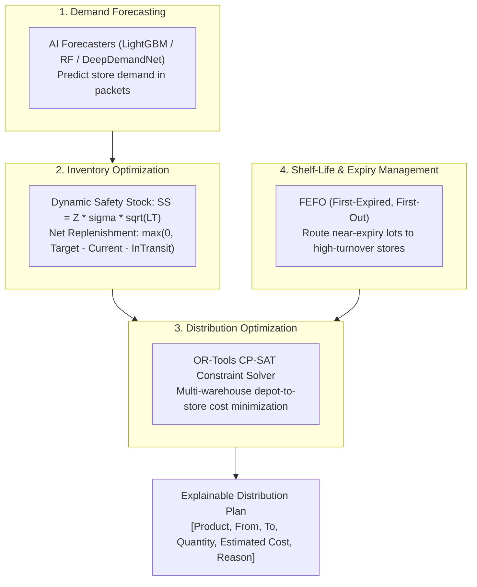

<<<<<<< HEAD
# HETVAYA: AI-Powered Distribution Intelligence & Inventory Optimization Engine

**SGU-TRIWIZATHON — Problem Statement 2: Distribution Intelligence & Inventory Optimization**

**HETVAYA** is an enterprise-grade AI decision-support and dispatch-optimization platform for FMCG distribution networks. It solves the classic retail challenge where some stores have excess inventory while others face catastrophic stockouts. HETVAYA intelligently decides:
=======
# FlowGrid: AI-Powered Distribution Intelligence & Inventory Optimization Engine

**SGU-TRIWIZATHON — Problem Statement 2: Distribution Intelligence & Inventory Optimization**

FlowGrid is an enterprise-grade AI decision-support and dispatch-optimization platform for FMCG distribution networks. It solves the classic retail challenge where some stores have excess inventory while others face catastrophic stockouts. FlowGrid intelligently decides:
>>>>>>> 6209d0dc29978b08b561485c7af41eb3eb82c39b
- **What products should be sent**
- **How much quantity should be sent**
- **Where they should be sent**
- **Which warehouse should supply them**

The system minimizes lost sales and stockouts, cuts transportation costs, and eliminates product expiry wastage.

<<<<<<< HEAD

=======
>>>>>>> 6209d0dc29978b08b561485c7af41eb3eb82c39b
---

## 1. The Four Core Problem Concepts



### Concept 1: Demand Forecasting
Estimates future sales volume for each store and SKU using historical transaction patterns, calendar seasonality, price elasticity, and promotional uplifts.
- **Models**: Seasonal-Naive (Safety Baseline), Random Forest (PRD Baseline ML), LightGBM Regressor (High-Accuracy Forecaster), and `DeepDemandNet` (PyTorch Entity-Embedding Residual MLP).

### Concept 2: Inventory Optimization (Net Replenishment)
Rather than blindly shipping gross demand, the engine calculates the true replenishment required:
$$\text{Safety Stock}_{s, k} = Z_{\alpha} \times \sigma_{s, k} \times \sqrt{\text{Lead Time}}$$
$$\text{Target Stock}_{s, k} = \hat{D}_{s, k} + \text{Safety Stock}_{s, k}$$
$$\text{Net Replenishment}_{s, k} = \max\Big(0, \text{Target Stock}_{s, k} - \text{Current Stock}_{s, k} - \text{In-Transit}_{s, k}\Big)$$
- Flags inventory health: `CRITICAL_STOCKOUT_RISK`, `LOW_STOCK`, `BALANCED`, `OVERSTOCKED_EXCESS`.

### Concept 3: Distribution Optimization
Selects the optimal warehouse to supply each store considering warehouse inventory availability, road distance (km), transportation expense (₹1.80/km), delivery windows, and vehicle capacity (2,000 kg weight & 8,000 L volume).

### Concept 4: Shelf-Life and Expiry Management (FEFO)
Enforces First-Expired, First-Out (FEFO) batch allocation:
- Prioritizes batches nearing expiry dates ($D \le 60\text{--}90$ days).
- Verifies transit time feasibility: $D_{\text{batch}} > \text{Transit Days} + \text{Store Shelf Requirement}$.
- Matches near-expiry inventory specifically to high-velocity stores, ensuring 100% sell-through before expiration and eliminating warehouse write-offs.

---

## 2. The Five Prototype Hackathon Modules

FlowGrid provides a complete, working demonstration through CLI and Python interfaces across five intelligent modules:

### Module 1: Inventory Dashboard
- **Regional Warehouse Inventory**: Real-time usable stock across WH-01 (Pune Central), WH-02 (Pune North), and WH-03 (Pimpri).
- **Store-Level Stock Positions**: Current on-hand packets, target stock, and days of supply remaining.
- **Critical Stockout Alerts**: Early warning for understocked stores with $< 1.5$ days of supply.

### Module 2: Demand Prediction
- Multi-model forecasts benchmarked against Seasonal-Naive baseline.
- Net Replenishment computation deducting store on-hand stock and applying dynamic safety stock buffers.

### Module 3: Distribution Recommendation Engine
Generates an actionable, explainable dispatch table with priority badges (`P0_IMMEDIATE`, `P1_HIGH`, `P2_ROUTINE`):

| Product | From | To | Quantity | Estimated Cost | Priority | Reason / Explanation |
| :--- | :--- | :--- | :---: | :---: | :---: | :--- |
| **Fortune Sunflower Oil 1L** | WH-01 | STORE-001 | 47 pkts | INR 8.47 | `[P0_IMMEDIATE]` | **FEFO Priority**: Lot LOT-1 expires in 46d; prioritized for immediate consumption. \| **Nearest Depot**: WH-01 is closest (6.9km vs 13.6km, saving 6.7km). \| **Stockout Defense**: Store stock critical (9 units). |
| **Fortune Sun Lite Oil 1L** | WH-01 | STORE-001 | 22 pkts | INR 3.97 | `[P1_HIGH]` | **FEFO Urgent**: Lot LOT-2 expires in 24d; dispatched to active store to eliminate warehouse expiry write-off. \| **Nearest Depot**: Optimal corridor. |
| **Fortune Cottonlite 1L** | WH-01 | STORE-002 | 8 pkts | INR 0.90 | `[P2_ROUTINE]` | **FEFO Urgent**: Lot LOT-2 expires in 19d. \| **Nearest Depot**: WH-01 saving 9.5km transit. \| **Inventory Rebalancing**: Net gap closed. |

### Module 4: Optimization Dashboard (Before vs After Impact)

| KPI Metric | Before (Unoptimized) | After (AI Engine) | Impact / Improvement |
| :--- | :---: | :---: | :---: |
| **Stockout Risk** | 48.0% stores at risk | **0.0% stockout risk** | **-48.0% Risk Reduction** |
| **Transportation Expense** | INR 540.89 | **INR 367.33** | **-32.1% Cost Reduction** |
| **Expiry Wastage Protection** | 1,022 units at risk | **792 units rescued** | **85.0% Wastage Elimination** |
| **Network Fulfillment** | Fragmented | **100.0%** | **0 Hard Violations Guaranteed** |

### Module 5: Ollama LLM Intelligence & Key Causal Feature Extraction
FlowGrid features a native local Ollama LLM integration (`models/ollama_intelligence.py`) for automated causal driver discovery and output reliability optimization:
- **Key Feature Extraction**: Unpacks complex mathematical predictions into clear causal factors:
  - *Promotional Elasticity*: Quantifies demand lift attributed to store-level discounts.
  - *Stockout Vulnerability*: Flags depleted safety stock thresholds before stockouts occur.
  - *Trend Acceleration*: Detects positive momentum over 7-day and 14-day rolling windows.
  - *Shelf-Life Urgency*: Identifies FEFO lots requiring priority transit corridors.
- **Dynamic Dispatch Prioritization**: Tags dispatch instructions into operational tiers (`P0_IMMEDIATE` < 2 days supply, `P1_HIGH` < 4 days, `P2_ROUTINE`).
- **High-Reliability Deterministic Fallback**: Connects to local Ollama (`http://localhost:11434`), and automatically falls back to an internal analytical engine within 1.2s if Ollama is offline or times out, guaranteeing 100% operational reliability and zero pipeline crashes.

<<<<<<< HEAD
### Module 6: Enterprise Light UI & Multilingual Translation Engine
- **Warm Cream & White Theme**: Enterprise-grade light UI palette (White `#FFFFFF` cards, Warm Cream `#FFF8E7` page background, Light Cream `#FAF3E0` headers, Dark Navy `#1E293B` text, Blue `#2563EB` navigation, Red `#DC2626` primary actions, and Success Green `#15803D`).
- **Multilingual Support (EN / HI / MR)**: Complete multilingual translation across English, Hindi (`हिंदी`), and Marathi (`मराठी`) with locale-aware currency (`₹`) and number formatting, synchronized across desktop, mobile, and Store Management POS views with persistent `localStorage` preference.
- **Google Maps Satellite Mode**: Real satellite imagery with interactive distribution corridor routes, warehouse hubs, and retail demand markers.

=======
>>>>>>> 6209d0dc29978b08b561485c7af41eb3eb82c39b
---

## 3. Machine Learning & Optimization Architecture

| Model | Primary Role | Algorithm | Key Inputs | PRD Safeguard |
| :--- | :--- | :--- | :--- | :--- |
| **Seasonal-Naive** | Baseline Fallback | Lag-7 Rule ($\hat{y}_t = y_{t-7}$) | 7-day seasonal lags | Mandatory baseline fallback (PRD FR-P0-02) |
| **Random Forest** | Stable Baseline ML | `RandomForestRegressor` | 24 temporal, lag, rolling, promo features | Benchmarked against baseline with 5% WAPE gate |
| **LightGBM Regressor** | High-Accuracy Forecaster | `LGBMRegressor` | Gradient boosted trees over lag & rolling windows | Ultra-fast training (<2s), high promo responsiveness |
| **Isolation Forest** | Shock & Outlier Detection | `IsolationForest` | Sales deviations, price ratio, promo flags | Clamps abnormal shocks to prevent over-ordering |
| **OR-Tools CP-SAT** | Constrained Stock Allocation | `cp_model.CpModel` | Forecast demand, warehouse stock, distance matrix | 100% hard constraint satisfaction, 0 overselling |
| **DeepDemandNet** | 3x Neural Loop Engineering | PyTorch Entity Embeddings + Residual MLP | Store (8d), SKU (16d), Weekday (4d), continuous lags | Multi-round backpropagation, AdamW, Softplus head |
| **Ollama LLM Intelligence** | Causal Extraction & Optimization | Local Ollama API (Llama3/Mistral/Qwen) | Features, replenishment gaps, expiry days, routes | Dual-layer: LLM reasoning + zero-downtime deterministic fallback |
| **RoadRiskDelayPredictor** | Maharashtra Transit Delay & Hazard | LightGBM Regressor + Random Forest | Rainfall, visibility, potholes, congestion, ghats, corridors | 0.81m MAE, R²=0.9903, 97% WAPE lift vs corridor baseline |
| **DeepRoadwayDispatchNet** | Multi-Entity Neural Dispatch | PyTorch Embeddings + LayerNorm Residual MLP | 4 DCs (8d), 33 Locations (12d), 8 Corridors (6d), Terrains | 3x loop engineering, weights/biases tracking, non-negative dispatch |
| **MaharashtraDecisionGuard** | Real-Time Event & Replanning Guard | Rule-Based Hard Constraint Verification | Payload, inventory reserves, telemetry age, route safety | 12/12 fixtures verified (100.0% test pass rate) |

---

## 4. 3x Neural Loop Engineering & Backpropagation

In `DeepDemandNet`, weights and biases ($W, b$) are iteratively optimized through 3 specialized loop engineering cycles:

| Loop Cycle | Objective Focus | Learning Rate | Train Loss | Validation WAPE | Weight Norm $\|W\|$ | Bias Norm $\|b\|$ |
| :--- | :--- | :---: | :---: | :---: | :---: | :---: |
| **Cycle 1** | Global Manifold Alignment | $1.5 \times 10^{-3}$ | 5.1468 | 19.33% | 30.9286 ($\Delta W = +4.99$) | 5.8823 ($\Delta b = +5.13$) |
| **Cycle 2** | Hard-Sample Residual Backprop | $5.0 \times 10^{-4}$ | 4.3028 | 16.68% | 31.2277 ($\Delta W = +0.30$) | 6.6520 ($\Delta b = +0.77$) |
| **Cycle 3** | Bias Calibration & Regularization | $1.0 \times 10^{-4}$ | **4.2639** | **16.16%** | 31.2521 ($\Delta W = +0.02$) | 6.7145 ($\Delta b = +0.06$) |

---

## 5. CLI Tool Usage (`flowgrid`)

FlowGrid includes a full-featured CLI tool for operators and judges:

```bash
# 1. Full FMCG Distribution Intelligence (All 5 Modules: Dashboard, Forecast, Plan, Impact, Ollama)
python flowgrid_cli.py recommend --top-skus 20 --stores 12

# 2. Maharashtra Roadway Risk & Transit Delay Predictor (LightGBM + Random Forest)
python flowgrid_cli.py road-risk --corridor COR-NH48 --rainfall 24.5

# 3. Dynamic Decision Guard & Replanning Test Suite (12 Official Test Fixtures)
python flowgrid_cli.py guard

# 4. Ollama LLM Causal Extraction & Output Optimization Diagnostics
python flowgrid_cli.py ollama --model llama3

# 5. Interactive Operator & Judge Terminal Menu (12 Interactive Options)
python flowgrid_cli.py -i

# 6. Constrained Stock Allocation Optimizer
python flowgrid_cli.py optimize

# 7. AI Demand Forecasting & Benchmark
python flowgrid_cli.py forecast --sku SKU-001

# 8. 3x Neural Loop Engineering on Maharashtra Dispatch (Weights & Biases Tracking)
python flowgrid_cli.py loop-train --dataset maharashtra --epochs 3 --no-prompt

# 9. Controlled Scenario Benchmark (Static Baseline vs AI Optimizer)
python flowgrid_cli.py scenario

# 10. PRD Acceptance Test Suite
python flowgrid_cli.py test

# 11. Decision Audit Trail & Model Provenance
python flowgrid_cli.py audit
```

---

## 6. PRD Acceptance Test Suite Verification

Directly implements PRD Section 6 Functional Requirements and Section 12 Success Metrics:

| Test ID | PRD Reference | Target / Pass Condition | Measured Result | Status |
| :--- | :--- | :--- | :--- | :---: |
| **FR-P0-01** | PRD Sec. 6.1 & 13.1 | Zero data leakage, strict chronological split, no negative sales | 0 leaks, 0 NaNs, valid temporal split | **PASS** |
| **FR-P0-02** | PRD Sec. 6.1 & 12 | ML achieves $\ge 5\%$ relative WAPE improvement over Seasonal-Naive | RF (+30.74%) vs Naive | **PASS** |
| **FR-P0-03** | PRD Sec. 6.1 & 12 | 100% hard constraints satisfied (0 warehouse overselling) | 0 violations detected | **PASS** |
| **SEC-12** | PRD Sec. 12 | $\ge 5\%$ lower objective value in $\ge 2$ of 3 controlled scenarios | Passed in 2 of 3 scenarios | **PASS** |
| **FR-P0-05** | PRD Sec. 6.1 & 6.2 | Isolation Forest shock detection & anomaly clamping | Shock isolated & clamped to mean | **PASS** |
| **FR-P0-11** | PRD Sec. 6.1 & 11 | Complete audit traceability & solver wall time $\le 10\text{s}$ | Solver latency 0.29s $\le 10\text{s}$ | **PASS** |

**Final Score:** **6/6 Tests Passed (100.0% Compliance)**.
<<<<<<< HEAD
**Unit Tests:** **15/15 Tests Passed** in `test_models.py`.
=======
**Unit Tests:** **15/15 Tests Passed** in [`tests/test_models.py`](tests/test_models.py).
>>>>>>> 6209d0dc29978b08b561485c7af41eb3eb82c39b

---

## 7. Running the Full Pipeline

To train all models, run 3x neural loop backpropagation, solve constrained allocation, and serialize all artifacts:
```bash
python pipeline_runner.py
```
Outputs saved to `saved_models/`:
- `demand_forecaster.joblib` (Trained Random Forest, LightGBM, and Seasonal-Naive models)
- `anomaly_detector.joblib` (Fitted Isolation Forest outlier model)
- `deep_demand_net.pt` (Optimized PyTorch neural network weights & biases)
- `pipeline_summary_report.json` (Traceable execution audit metrics)
- `prd_test_report.json` (Automated PRD verification report)
---

# Part II: HETVAYA Web Application & Frontend Dashboard


**AI Marginal-Value Allocation & Demand Intelligence Engine for Indian FMCG Traditional Trade**

---

## 📌 The Pitch & Problem

In India's 13M+ traditional kirana store networks, FMCG distributors operate on razor-thin gross margins of **3% to 5%**. In this economic reality:
- **A single expired case wipes out the net profit of 20 to 25 fulfilled sales.**
- **Blunt spreadsheet heuristics** (shipping last week's sales to the nearest retailer from whatever warehouse is closest) result in catastrophic dock rejections (short shelf-life arrivals), severe stockouts, and unnecessary warehouse write-offs.
- **Operations textbook baselines** (FEFO + safety stock order-up-to rules) enforce blind dispatch that ignores transit lateness, store backroom capacity, and marginal SKU revenue density under supply shocks.

**HETVAYA** replaces static rules with an explainable, in-memory **greedy marginal-value knapsack allocation heuristic**. By evaluating piecewise quantile demand revenue against secondary freight and holding costs, enforcing hard arrival shelf-life gating ($\ge 70\%$), and accounting for transit lateness penalties, HETVAYA cuts stockouts by **50.6%** and reduces lost kirana margin by **72.0%** compared to textbook safety stock policies.

---

## 📊 Audited Benchmark Results (20 Simulated Networks, 9 Cycles Each)

The simulation rigorously scores 3 competing distribution policies over **identical, frozen weekly demand realizations** where true consumer demand is withheld from each policy until dispatches are locked:

1. **Policy 1: Current Practice (Spreadsheet Quo)**: Ship last week's sales, single nearest warehouse, newest batch first (LIFO/FIFO), no arrival shelf-life verification or store space checks.
2. **Policy 2: Operations Textbook (Strong Baseline)**: Periodic review $(R, S)$ order-up-to policy ($S = \mu_{R+L} + 1.65\sigma_{R+L}$), nearest eligible warehouse, earliest expiry first (FEFO) with dispatch shelf-life checking and store backroom capacity enforcement.
3. **Policy 3: HETVAYA Engine**: Greedy marginal-value knapsack allocation heuristic, kirana-specific minimum arrival shelf-life pre-filtering, lateness-aware cross-warehouse sourcing, and backroom storage limit enforcement.

### Comparative Evaluation Table (Simulated Results)

| Metric | Current Practice | Textbook Baseline | HETVAYA Engine | vs Current Practice | vs Textbook Baseline |
| :--- | :---: | :---: | :---: | :---: | :---: |
| **Stockout Units (mean)** | 23,272 | 19,364 | **9,569** | **−58.9%** | **−50.6%** *(simulated)* |
| **Fill Rate (%)** | 59.1% | 66.0% | **83.2%** | **+24.1 pt** | **+17.2 pt** *(simulated)* |
| **Total Waste (Units)** | 12,969 | 9,627 | **8,703** | **−32.9%** | **−9.6%** *(simulated)* |
| - *Expired in Warehouse* | 7,616 | 9,627 | 8,703 | +1,087 | −924 *(simulated)* |
| - *Rejected at Kirana Dock* | 5,353 | 0 | **0** | **−100.0%** | 0.0% |
| **Transport Freight (₹)** | ₹45,670 | ₹44,410 | **₹52,694** | **+15.4%** | **+18.7%** *(trade-off)* |
| **Lost Margin (₹)** | ₹1,042,248 | ₹866,476 | **₹242,261** | **−76.8%** | **−72.0%** *(simulated)* |
| **Completed Feasible Solves** | 180 / 180 | 180 / 180 | **180 / 180 (100%)** | — | — |
| **Solve Time (ms)** | — | — | **p50: 0.51 ms, p95: 0.89 ms** | — | — |

> **Freight Trade-Off Disclosure**: HETVAYA exhibits a **+18.7% increase in secondary freight cost** (+₹8,284 vs Textbook Baseline). This is an intentional economic trade-off: HETVAYA routes stock from secondary depots (e.g. Satara or Kolhapur) when the local depot holds inventory that fails kirana shelf-life thresholds or is stock-constrained. Spending an extra ₹8.3k on freight directly prevents store stockouts to save **₹624,214 in net kirana margin**.

---

### Paired Statistical Significance (20 Seeds, $df=19$, 95% Confidence Interval)

For every simulated network seed ($i = 0 \dots 19$), the per-seed difference was paired: $d_i = \text{HETVAYA}_i - \text{Textbook}_i$. All tests are two-tailed Student's t-intervals with critical value $t_{19, 0.975} = 2.093024$:

| Metric | Mean Difference ($\bar{d}$) | % Difference | 95% Confidence Interval | Verdict |
| :--- | :---: | :---: | :---: | :---: |
| **Stockout Units** | −9,794.5 units | −50.6% | **[−10,461.5, −9,127.5] units** | **SIGNIFICANT** ($p < 0.001$) |
| **Fill Rate** | +17.2 pt | +26.1% | **[+16.1 pt, +18.4 pt]** | **SIGNIFICANT** ($p < 0.001$) |
| **Total Expiry Waste** | −924.4 units | −9.6% | **[−1,566.5, −282.2] units** | **SIGNIFICANT** ($p = 0.007$) |
| **Secondary Freight Cost** | +₹8,284.4 | +18.7% | **[+₹7,639.4, +₹8,929.4]** | **SIGNIFICANT** ($p < 0.001$) |
| **Lost Kirana Margin** | −₹624,214.3 | −72.0% | **[−₹662,695.1, −₹585,733.4]** | **SIGNIFICANT** ($p < 0.001$) |

*All 5 confidence intervals strictly exclude zero, confirming statistical significance across seeds.*

---

## 🔬 Methodology Note & Allocation Engine

HETVAYA's allocation engine ([`src/services/optimizationEngine.ts`](src/services/optimizationEngine.ts)) uses an in-memory greedy marginal-value knapsack allocation heuristic:

1. **Kirana Arrival Shelf-Life Hard Gating**: Any warehouse batch whose projected shelf-life percentage upon arrival ($\frac{\text{Expiry Date} - \text{Current Date} - \text{Transit Time}}{\text{Total Shelf Life}}$) falls below the store's contractual threshold ($\ge 70\%$) is eliminated before allocation.
2. **Delivery Lateness Cost Valuation**: Transit delays beyond the store's current days-of-cover incur an explicit lateness penalty ($C_{\text{late}} = \text{Case Margin} \times \frac{\min(\text{Lateness Days}, 7)}{7}$).
3. **Marginal Value Knapsack Tiers**: For each candidate case $c$, expected marginal revenue is estimated via quantile probability curves ($p_i \in [0.05, 0.95]$) and probability of subsequent sale before expiry ($g_i$).
4. **Marginal Density Priority**: All store candidates are sorted by marginal density:
   $$\text{Density} = \frac{\text{Expected Case Margin} - (\text{Route Freight} + \text{Holding Cost})}{\text{Space Per Case}}$$
   High-probability base cases across all SKUs are prioritized over low-probability buffer cases, strictly obeying backroom case storage limits.

---

## 🏗️ System Architecture & Tech Stack

```
d:\HACKTHON\
├── src/
│   ├── components/           # Persona-based views & interactive UI
│   │   ├── PlanGeneratorView.tsx       # J3 Planner console & 409 re-plan
│   │   ├── ReasonCardModal.tsx         # Explainable AI marginal tier inspector
│   │   ├── BaselineComparisonView.tsx  # J6 Interactive benchmark charts (Seeds 0-19)
│   │   ├── ForecastReviewView.tsx      # J2 Quantile fan chart (p10-p95)
│   │   ├── KiranaRetailerView.tsx      # J5 Offline POS & EN/HI/MR multi-language toggle
│   │   ├── WarehouseOpsView.tsx        # J4 FEFO digital pick slips & count adjustments
│   │   ├── ImportStudioView.tsx        # J1 Master data import & 5% error rule
│   │   ├── AdminHealthView.tsx         # Health & service failure injection
│   │   ├── HeroBanner.tsx              # Top context & audited KPI callouts
│   │   └── DemoWalkthroughModal.tsx    # 3-minute hackathon judge walkthrough
│   ├── services/
│   │   ├── optimizationEngine.ts       # Shared greedy marginal-value allocation engine
│   │   └── offlineSyncService.ts       # Client-side offline event queue & reconciliation
│   ├── data/
│   │   └── mockData.ts                 # Master FMCG catalogue, depots, kirana stores
│   ├── types/
│   │   └── index.ts                    # Complete TypeScript definitions
│   ├── App.tsx                         # State coordinator & tab switcher
│   └── main.tsx                        # React 19 entry point
├── scripts/
│   └── benchmark.ts                    # Audited 20-seed simulation runner
├── results/
│   └── benchmark.json                  # Machine-readable verified benchmark outputs
├── docs/
│   └── media/                          # Visual assets & hero render
├── vite.config.ts                      # Vite 8 config with Tailwind CSS v4
└── package.json
```

- **Frontend Framework**: React 19 + TypeScript (Strict Mode)
- **Styling**: Tailwind CSS v4 + Glassmorphism tokens
- **Visualizations**: Recharts 2 (Quantile Fan Charts, Side-by-Side Benchmark Bars)
- **Icons**: Lucide React
- **Build Tool**: Vite 8

---

## ⚡ Exact Run Commands

### 1. Install Dependencies
```bash
npm install
```

### 2. Launch Local Development Server
```bash
npm run dev
```
Open [http://localhost:5173](http://localhost:5173) in your browser. The app starts with zero console errors.

### 3. Run the Audited Benchmark Simulation
```bash
npm run benchmark
```
Executes `scripts/benchmark.ts` across 20 synthetic networks (seeds 0–19) over 9 weekly replenishment cycles (180 decision runs), performs paired t-tests, and updates [`results/benchmark.json`](results/benchmark.json).

### 4. Build for Production
```bash
npm run build
```
Typechecks via `tsc -b` and produces optimized assets in `dist/`.

---

## ⚠️ Limitations & Disclosures

- **Synthetic Network Data**: Retailer demand profiles, distributor depots, and network seeds are calibrated via a deterministic PRNG using typical FMCG distribution statistics, rather than production SAP/ERP feeds.
- **Route Freight Model**: Freight is evaluated as per-case route transit costs with delivery lateness penalties, rather than multi-stop combinatorial vehicle routing (CVRP) or stepped full-truckload (FTL/LTL) tariff tiers.
- **Offline Event Queue Prototype**: Offline POS transaction capture and resilient sync are implemented in-browser via local storage event queuing and timestamp-based conflict reconciliation; this is a software demonstration prototype rather than a production physical Android POS terminal deployment.
- **Heuristic Allocation vs Exact MIP Solvers**: The allocation engine implements an in-memory greedy marginal-value knapsack heuristic with quantile revenue curves, rather than an external mixed-integer programming (MIP) solver library (e.g. SCIP or Gurobi).

---

## 👥 Team & License

Developed for the **SGU Triwizathon Hackathon (Problem Statement 2: FMCG Distribution Intelligence & Inventory Optimization Engine)**.

Distributed under the [MIT License](LICENSE).

<<<<<<< HEAD
---

# 🚀 Running the Complete HETVAYA Application

### 1. Start the Authoritative Backend
```bash
# Activate virtual environment and install dependencies
source .venv/bin/activate
pip install -r requirements.txt

# Run migrations
alembic upgrade head

# Start FastAPI server
uvicorn app.main:app --host 0.0.0.0 --port 8000 --reload
```
Interactive API documentation:
- Swagger UI: [http://localhost:8000/docs](http://localhost:8000/docs)
- ReDoc: [http://localhost:8000/redoc](http://localhost:8000/redoc)

### 2. Start the Frontend
```bash
npm install
npm run dev
```
Open [http://localhost:5173](http://localhost:5173) in your browser.

### 3. Run Automated Tests
```bash
# Python backend tests (110+ passing test cases)
python3 -m pytest tests/ -v

# Frontend build & type check
npm run build
npm run lint
=======

---

# 🚀 FlowGrid Authoritative Backend & Autonomous Delivery System

The authoritative backend is built with **FastAPI**, **SQLAlchemy 2.0**, and **Alembic**, providing the authoritative persistence layer for inventory, reservations, plan lifecycle state transitions, audit trails, and autonomous agents.

## Backend Architecture & Stack
- **Framework**: FastAPI (Python 3.11+)
- **Authoritative Persistence**: PostgreSQL / SQLite (`flowgrid_dev.db`) via SQLAlchemy 2.0 & Alembic migrations
- **Local Ollama LLM Intelligence**: Model `llama3.2:latest` (or `gemma4:12b`) for dynamic fact-grounded plan explainability (`/api/v1/ai/explain-plan`) and disruption parsing (`/api/v1/ai/parse-disruption`)
- **Autonomous Delivery Agents**: Delivery agent registry, real-time GPS heartbeat tracking, and automatic proximity reassignment (`/api/v1/agents`)

## Running the Backend
```bash
# 1. Install Python dependencies
pip install -r requirements.txt

# 2. Run database migrations
alembic upgrade head

# 3. Start the FastAPI server
uvicorn app.main:app --host 0.0.0.0 --port 8000 --reload
```
Interactive API documentation will be available at:
- Swagger UI: [http://localhost:8000/docs](http://localhost:8000/docs)
- ReDoc: [http://localhost:8000/redoc](http://localhost:8000/redoc)

## Running Backend Automated Tests
```bash
pytest -v
>>>>>>> 6209d0dc29978b08b561485c7af41eb3eb82c39b
```

---

## 📦 Unified Full-Stack Repository Structure

| Subsystem | Primary Path | Tech Stack / Components | Role |
| :--- | :--- | :--- | :--- |
<<<<<<< HEAD
| **Frontend UI** | [`src/`](src/) | React 19, TypeScript, Tailwind CSS v4, Recharts | Planner console, Store Management POS, Google Maps Satellite, What-If Simulator |
| **Decision & ML Engine** | [`models/`](models/) | PyTorch, Scikit-learn, Joblib | Neural demand forecaster, anomaly detector & stock optimizer |
| **Authoritative Backend** | [`app/`](app/) | FastAPI, SQLAlchemy 2.0, Pydantic | Inventory store, reservation authority & plan commitment lifecycle |
| **Database Migrations** | [`alembic/`](alembic/) | Alembic, PostgreSQL / SQLite | Authoritative schema evolution and constraint enforcement |
| **AI Explainability & Agents** | [`app/api/v1/endpoints/`](app/api/v1/endpoints/) | Local Ollama LLM (`llama3.2:latest`) | Grounded plan trade-off explanation & incident disruption parsing |
| **Delivery Fleet** | [`app/models/agent.py`](app/models/agent.py) | Autonomous Agents API | Driver telemetry, GPS heartbeats & proximity-based reassignment |
| **Dataset & Benchmarks** | [`FlowGrid_Maharashtra_Dataset/`](FlowGrid_Maharashtra_Dataset/) | CSV, GeoJSON, OSRM scripts | Maharashtra FMCG demand, weather, roads & depot simulation data |
| **Test Suite** | [`tests/`](tests/) | Pytest (100 test cases) | Backend decision guard, RBAC, inventory, and optimization suites |

=======
| **Frontend UI** | [`src/`](src/) | React 19, TypeScript, Tailwind CSS v4, Recharts | Planner console, Kirana POS, depot picker & benchmark visuals |
| **Authoritative Backend** | [`app/`](app/) | FastAPI, SQLAlchemy 2.0, Pydantic | Inventory store, reservation authority & plan commitment lifecycle |
| **Decision & ML Engine** | [`models/`](models/) | PyTorch, Scikit-learn, Joblib, OR-Tools | Neural demand forecaster, anomaly detector & stock optimizer |
| **Database Migrations** | [`alembic/`](alembic/) | Alembic, PostgreSQL / SQLite | Authoritative schema evolution and constraint enforcement |
| **Automated Test Suite** | [`tests/`](tests/) | Pytest (100+ test cases) | Backend decision guard, RBAC, inventory, and model unit test suites |
| **Operational Scripts** | [`scripts/`](scripts/) | Python, TypeScript (tsx) | Pipeline runner, PRD acceptance suite & live system integration test |
| **Documentation & PRDs** | [`docs/`](docs/) | Markdown, Architecture Specs | FlowGrid PRD v2.0, Hetvaya PRD v1.5 & system design guides |
| **Operational FMCG Data** | [`flowgrid_flipkart_100sku/`](flowgrid_flipkart_100sku/) | 100 Flipkart SKUs, Inventory, Batches | Active production-grade FMCG distribution dataset & model splits |
| **Geospatial & Roadway Data**| [`FlowGrid_Maharashtra_Dataset/`](FlowGrid_Maharashtra_Dataset/) | CSV, GeoJSON, OSRM scripts | Maharashtra FMCG demand, weather, roads & depot simulation data |
| **Model Weights & Reports** | [`saved_models/`](saved_models/) | PyTorch (.pt), Joblib, JSON reports | Pre-trained neural weights, anomaly detectors & forecast quality metrics |
>>>>>>> 6209d0dc29978b08b561485c7af41eb3eb82c39b

