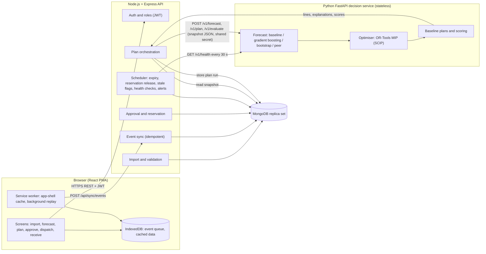
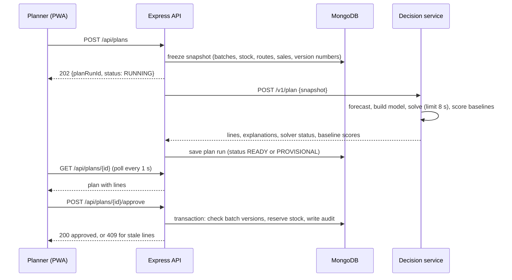
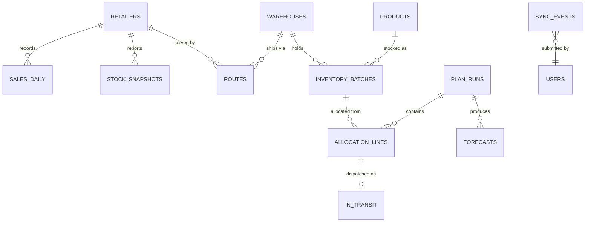

# FINAL PRD — HETVAYA Distribution Intelligence & Inventory Optimization Engine

## 1. Document Overview

| Item | Detail |
| --- | --- |
| Product | HETVAYA Distribution Intelligence & Inventory Optimization Engine |
| Problem statement | Problem Statement 2: AI-Powered Distribution Intelligence & Inventory Optimization Engine (FMCG) |
| Version | 1.5 (submission), 24 October 2026 |
| Document owner | Shrikrishna Lomate |
| Status | Ready for team review and factual verification before submission |

**Objectives**

1. Recommend, every replenishment cycle, which product to send from which warehouse to which retailer, in how many cases, from which batch.
2. Cut stockouts, transport cost and expiry waste substantially compared with the current planning rule, and match a strong textbook baseline on stockouts while using less freight and wasting less stock, all measured on the same data.
3. Explain every recommendation in terms a planner can check: forecast, stock position, cost, shelf life and the alternative not chosen.
4. Keep stock counts, sales and delivery receipts capturable at retailers and warehouses with weak connectivity, and synchronise them without loss or double counting.

**Scope.** Weekly allocation of finished FMCG goods from 2–20 warehouses to up to a few hundred retailers, for up to a few hundred SKUs, with batch-level expiry. Recommendations are approved by a person; the system does not dispatch, purchase or route vehicles.

**Intended users.** Distribution planners, warehouse managers, retailers or store managers, and a system administrator (section 4).

**Reading guide.** Facts with sources are marked as such; assumptions that need validation are listed in sections 3.3 and 19. Section 17.2 contains results already measured on a simulation prototype; every other number in this document is a proposed target.

## 2. Executive Summary

**Problem.** About 85–90% of India's mass grocery retail runs through traditional trade, mainly its 13–14 million kirana stores, supplied by distributors who work on margins of 3–5% (section 3.2). These distributors decide each week how much of each product to send from each warehouse to each retailer. Most decide from last week's sales. That rule ships too little after a stockout (zero sales look like zero demand), sends stock from the nearest warehouse even when another is cheaper or holds older batches, and ignores whether a batch will still meet the retailer's minimum shelf life when it arrives. The results are empty shelves, avoidable freight and expired stock.

**Solution.** A web application (React PWA + Express + MongoDB) with a Python decision service (FastAPI). Each cycle it:

1. **Forecasts demand per retailer and SKU** as a range (10th to 95th percentile), using a moving-average baseline and switching to a scikit-learn gradient-boosting model only when that model beats the baseline on the most recent week. Stockout days are removed before training.
2. **Allocates stock with an exact optimisation model** (Google OR-Tools, mixed-integer programming). Each additional case for a retailer is valued by its probability of selling, read from the forecast range, and by whether it can still sell before it expires. A case is shipped only when that expected margin exceeds its freight, holding cost and lateness cost. Batches that would arrive below the retailer's shelf-life minimum are never shipped, and where a store's storage space is recorded, it is never sent more than it can hold; the space goes to the cases worth most.
3. **Explains and gates every line**: the planner sees why each case was sent, which constraint limited it, and the cheaper or faster option that was not used, then approves or overrides. Nothing ships automatically.
4. **Captures stock, sales and receipts offline** in the browser and synchronises them once, in order, with stale-data warnings.

**Core differentiator.** Allocation by the **marginal value of each case**: one model combines forecast uncertainty, shelf life on arrival, delivery lateness and freight in rupees, instead of shipping every SKU to the same buffer and checking expiry afterwards. Section 16 separates this mechanism from the standard components it is built on.

**Evidence already available.** A simulation prototype of the decision service (OR-Tools + scikit-learn, the same algorithms specified here) was compared on 20 simulated networks with hidden true demand (section 17.2):

| HETVAYA compared with | Stockout units | Expired units | Transport ₹ |
| --- | --- | --- | --- |
| Current practice (ship last week's sales, nearest warehouse) | −40.0% | −25.8% | −13.8% |
| Strong baseline (moving average + safety stock, earliest expiry first) | +3.5% | −2.5% | −2.8% |

270 of 270 optimisation runs returned a proven optimum; the 95th-percentile solve time was 0.07 s. Against current practice the gains are large and consistent; against the strong baseline they are small: in the main set, less waste (17 of 20 networks) and freight (15 of 20) with stockouts roughly equal; in the stress set, less waste and fewer stockouts but 1.5% more freight. These are simulation results, not field results; section 17.3 lists the proposed targets for the build and the pilot.

## 3. Problem Statement and User Empathy

### 3.1 The problem

Each week a distributor holds stock in several warehouses, in batches with different expiry dates, and must decide what to send to each retailer. Four things vary at the same time: demand by retailer and week, stock by warehouse and batch, freight cost and transit days by route, and remaining shelf life. Getting it wrong produces three costs that pull against each other: stockouts (lost sales), excess shipments (freight, holding, and later expiry), and expired or rejected stock.

### 3.2 Documented facts

| Fact | Figure | Source |
| --- | --- | --- |
| Kirana stores in India; share of mass grocery retail through traditional trade | 13–14 million stores; about 85–90% | Redseer Strategy Consultants, [Rethinking the FMCG market in India's hybrid retail economy](https://redseer.com/digests/rethinking-fmcg-market-in-indias-hybrid-retail-economy/), 30 March 2026 |
| FMCG distributors and sub-distributors represented by AICPDF; average distributor margin | Over 400,000 distributors and 350,000 sub-distributors; 3–5% | AICPDF figures reported by [Business Standard](https://www.business-standard.com/industry/news/fmcg-distributors-rally-to-defend-turf-against-online-competitors-125011200488_1.html), 12 January 2025 |
| Average retail out-of-stock rate in FMCG (developed markets) | 8.3% | Gruen & Corsten, *A Comprehensive Guide to Retail Out-of-Stock Reduction in the FMCG Industry*, 2008 |
| Sales lost by a typical retailer to out-of-stocks | about 4% | Gruen, Corsten & Bharadwaj, *Retail Out-of-Stocks: A Worldwide Examination*, Grocery Manufacturers of America, 2002 |
| Share of Indian FMCG distributor costs taken by logistics, manpower and secondary transport | up to ₹57 of every ₹100 | All India Consumer Products Distributors Federation (AICPDF), reported by [Business Today](https://www.businesstoday.in/amp/india/story/give-us-margin-support-or-risk-rural-stockouts-distributors-warn-indias-fmcg-giants-535639-2026-06-08), 8 June 2026 |
| Distributors warn of rural retail stockouts if servicing frequency falls | qualitative | Same source |
| Near-expiry FMCG stock pushed into discount channels | qualitative | AICPDF, reported by [Storyboard18](https://www.storyboard18.com/how-it-works/fmcg-cos-dumping-near-expiry-products-through-quick-commerce-aicpdf-46716.htm), 6 November 2024 |
| Food wasted in India per year; retail's share of global food waste | 78–80 million tonnes (≈ ₹1.55 lakh crore); about 12% | UNEP Food Waste Index 2024, summarised by [Drishti IAS](https://www.drishtiias.com/daily-updates/daily-news-analysis/indias-food-waste-conundrum/print_manually) |

**Why these facts matter for the design.** Most mass grocery retail in India still runs through small stores supplied by distributors, so the target user serves the main channel, not a niche. At a 3–5% margin on the selling price, the cost of one written-off case equals the margin earned on about 19–32 cases sold ((1 − 0.05) ÷ 0.05 = 19; (1 − 0.03) ÷ 0.03 ≈ 32) wherever the distributor bears the loss, and a freight trip that is refused and repeated can do the same. This is why the allocation model (section 14) prices freight, lateness and expiry in rupees against the margin of each case, rather than optimising fill rate alone.

Most food waste is household waste. This product addresses only waste that arises in distribution and retail: stock that expires because it was sent to the wrong place, in the wrong amount, or too late.

### 3.3 Assumptions that need validation

| ID | Assumption | How it will be validated | What changes if it is contradicted |
| --- | --- | --- | --- |
| A1 | Target distributors plan weekly dispatch from last week's sales in spreadsheets | 3–5 interviews with distributors or planners before the pilot; recorded as role + quote + which assumption it supports or contradicts | If they already use ERP min–max points, the strong baseline becomes the comparison of record and the value case rests on waste, freight and per-line reasons (section 16), not on the large gain over current practice |
| A2 | They can export stock by batch, daily sales by retailer, and a route cost table | Same interviews; a sample export from one distributor | Without batch-level stock, each SKU's oldest known expiry is used for the shelf-life rule and lines are flagged; without route costs, distance bands with a default ₹ per case are entered at onboarding |
| A3 | Retailers apply a minimum remaining shelf life on delivery (modern trade often around 70%; kirana stores less formally) | Interviews; per-retailer field in the data, default shown as a default | Default set to 0 for stores with no rule; rejected receipts (FR-12) are then the evidence used to set it |
| A4 | Retailers or field staff can record stock counts and receipts on a phone browser | Pilot with one retailer for two weeks | The distributor's field sales representative records counts on the weekly visit; the event and sync design (section 15) is unchanged, only the user role differs |
| A5 | Small stores have limited storage space, so over-delivery causes refusals | Interviews; receipts rejected with reason "no space" | The storage limit stays optional and unset; nothing else changes |

No customer interviews have been conducted yet; the personas in section 4 are composites built from the problem statement and the facts above.

**Interview guide (15 minutes, before the pilot).** 1. Walk me through how you decided last week's dispatch quantities; may I see the sheet? 2. When did a delivery last get refused, and why? 3. Which products expired in your warehouse last month, and why did they not move? 4. What data can you export today, and in what format? 5. Would you approve a recommended plan line by line, and what would you need to see to trust it? Each answer is recorded against A1–A5 as supporting, contradicting or unclear; any persona or default that is contradicted is changed before the pilot.

### 3.4 What the problem costs one distributor (simulated)

In the simulation of section 17.1 (3 warehouses, 12 retailers, 20 SKUs, about 15,900 units of demand a month), the three planning rules produce these monthly averages over 20 networks. They illustrate the scale of the problem; they are not field measurements.

| Per month | Current practice | Strong baseline | HETVAYA |
| --- | --- | --- | --- |
| Margin lost to stockouts | ₹85,340 | ₹50,485 | ₹49,958 |
| Freight | ₹18,740 | ₹16,710 | ₹16,272 |
| Units expired or rejected | 4,163 | 3,219 | 3,118 |

Moving from current practice to HETVAYA is worth about ₹35,400 of margin and ₹2,500 of freight a month, and about 1,000 fewer expired units, in this simulated network. Most of that gain is also available from a well-run textbook policy; HETVAYA's additional gain over that policy is small and comes mainly from less waste (section 17.2).

### 3.5 Root causes

| # | Root cause | Consequence |
| --- | --- | --- |
| RC1 | Shipments follow last week's sales | Festival weeks and trends are missed; intermittent SKUs are over- or under-sent |
| RC2 | Sales on stockout days are read as demand | Each stockout lowers the next shipment, so stockouts repeat |
| RC3 | Every SKU gets the same buffer | Short-life, low-margin goods are over-sent and expire; long-life, high-margin goods run out |
| RC4 | Nearest warehouse ships first | Older batches elsewhere expire; cheaper routes are ignored |
| RC5 | Shelf life checked at dispatch, not on arrival | Retailers reject deliveries; freight is paid twice |
| RC6 | Transit time ignored | A cheap but slow source arrives after the shelf is empty |
| RC7 | Recommendations without reasons | Planners override tools and return to spreadsheets |
| RC8 | Stock counts and receipts arrive late or twice from the field | Plans are made on wrong stock, causing duplicate or missing shipments |

### 3.6 Why existing approaches are insufficient

| Approach | What it does well | What it misses |
| --- | --- | --- |
| Spreadsheet "ship last week's sales" | Simple, familiar | RC1, RC2, RC3, RC4, RC5, RC6 |
| ERP min–max reorder points | Automates replenishment per item and location | One fixed buffer per item (RC3); usually no batch-level shelf life on arrival (RC5); no network-wide choice of source warehouse (RC4) |
| Inventory dashboards | Show stock and sales clearly | Do not decide quantities or sources |
| Enterprise planning suites | Full network optimisation | Assumed to need integration projects and clean master data beyond a mid-size distributor's means (assumption A2; to be validated) |

## 4. User Personas

| Persona | Role and responsibilities | Pain points | Goals | Decisions the system supports |
| --- | --- | --- | --- | --- |
| **Rohit — distribution planner** | Plans weekly dispatch for 3 warehouses and about 12 retailers | Plans from last week's sales; festival spikes catch him short; cannot justify quantities to his manager | Fewer stockouts without more freight; a plan he can defend | How much of each SKU each retailer gets, from which warehouse and batch; which lines to override |
| **Sunita — warehouse manager** | Runs one warehouse; picks and dispatches approved lines | Finds expired stock at month-end; deliveries rejected for short shelf life; dock overloaded on some days | Oldest eligible batches out first; dispatch within capacity | Which batches to pick; whether a line is feasible today; recording dispatch and stock counts offline |
| **Ganesh — retailer / store manager** | Owns a kirana store; receives deliveries | Empty shelves on fast movers; short-dated stock he must refuse; deliveries larger than his storeroom; patchy network in the store | The right stock, fresh enough to sell | Recording stock counts, sales and accepted or rejected deliveries from a phone, offline if needed |
| **Priya — system administrator** | Sets up users, master data and routes | Bad imports corrupt plans; duplicate records | Clean data and controlled access | Approving master-data imports; managing roles; monitoring sync health |

## 5. Product Objectives and Scope

### 5.1 Measurable objectives

| ID | Objective | Measure (section 17) |
| --- | --- | --- |
| O1 | Fewer stockouts than current practice and no worse than the strong baseline | Stockout units, fill rate |
| O2 | Less expiry and rejection waste | Expired + rejected units and ₹ |
| O3 | Lower transport cost at equal or better fill rate | Transport ₹ |
| O4 | Plans that never break modelled limits | Constraint violations = 0 |
| O5 | Explainable, approved decisions | Lines with explanation = 100%; nothing dispatched without approval |
| O6 | Reliable offline capture | Lost and duplicated events = 0 in sync tests |

### 5.2 In scope (MVP)

Master-data and inventory import; offline capture of stock counts, sales and receipts; demand forecast with ranges; allocation optimisation with stock, capacity, shelf-life-on-arrival and lateness rules; explanations; approval and override; dispatch and receipt recording; comparison against two baselines on simulated data; role-based access.

### 5.3 Out of scope

Purchasing from manufacturers; vehicle routing and truck loading; pricing and promotions; transfers between retailers; payment collection; live ERP integrations; automatic dispatch; any use of a large language model for decisions.

### 5.4 Boundaries and assumptions

Weekly replenishment cycle; each retailer served once per cycle; route cost per case and transit days fixed per route; unmet demand is lost, not back-ordered; all money in INR; one distributor network per deployment.

### 5.5 Traceability: root cause → requirement → KPI → test

| Root cause (section 3.5) | Requirements | KPI (section 17.3) | Tests (section 18) |
| --- | --- | --- | --- |
| RC1 Shipments follow last week's sales | FR-08, FR-18 | Forecast accuracy, forecast calibration | T5, T13 |
| RC2 Stockout days read as demand | FR-08 (stockout correction) | Forecast accuracy, stockout rate | T5, T13 |
| RC3 Same buffer for every SKU | FR-09 (value tiers, storage limit) | Lost margin, expiry and rejection waste | T1, T13, T21 |
| RC4 Nearest warehouse first | FR-09 | Transport cost, expiry and rejection waste | T2, T13 |
| RC5 Shelf life checked at dispatch | FR-09 (arrival rule), FR-12 | Expiry and rejection waste | T3 |
| RC6 Transit time ignored | FR-09 (lateness cost, fastest candidate) | Stockout rate | T4, T15 |
| RC7 Recommendations without reasons | FR-10, FR-11, FR-11b | Explanation coverage, override rate | T2, T4 (reason cards), T9 (approval) |
| RC8 Late or duplicate field data | FR-05, FR-06, FR-07, FR-12 | Sync reliability, stale-data exposure, reservation hygiene | T7, T8, T14, T16, T17, T18, T20 |

## 6. Core User Journeys

**J1 — Import and validate data (Priya, Rohit) · P0.**

1. Upload CSV or XLSX files for products, warehouses, retailers, routes, inventory batches and sales history (section 11), or sync them from the field app.
2. The system validates types, units, dates, foreign keys and duplicates and shows each problem with its file and row ("inventory.csv:14 — expiry date missing").
3. Import rule (the same for every file type): if 5% or fewer of the rows fail validation, the valid rows are committed in one transaction and the rejected rows are listed for correction; if more than 5% fail, nothing is committed. A broken file therefore cannot half-update stock.

**J2 — Review demand (Rohit) · P0.**

1. Opens the forecast view: for each retailer and SKU, next-cycle demand as a median and a 10–95% range, the method used, and a flag where stockout days were corrected or history is short.
2. Sorts by largest gap between forecast and current stock.

**J3 — Generate and approve recommendations (Rohit) · P0.**

1. Presses **Generate plan**. The plan is created from a frozen snapshot of stock and forecasts; it returns within 10 seconds for the demo network.
2. Each line shows warehouse → retailer, SKU, batch, cases, freight ₹, arrival day, remaining shelf life on arrival, and a reason card (example in section 14.6).
3. Approves the plan or overrides lines with a reason. If stock changed since the snapshot, approval of the affected lines is refused; one click re-plans only those retailers from a fresh snapshot (FR-11b).
4. Approved lines reserve stock until the end of the cycle and appear on the warehouse dispatch list; a line that is not dispatched in time is released automatically.

**J4 — Dispatch and receive (Sunita, Ganesh) · P0.**

1. Sunita marks lines dispatched; stock moves to in-transit.
2. Ganesh records the delivery: cases accepted and cases rejected with a reason (short shelf life, damaged). This works offline and syncs later.

**J5 — Capture stock and sales offline, then synchronise (Ganesh, Sunita) · P0.**

1. With no network, the app stores stock counts, sales and receipts in the browser (IndexedDB) with a unique event ID each.
2. When the connection returns, queued events are sent in order; the server applies each event once and reports any conflict.
3. A banner shows when data was last synchronised; the planner sees which retailers' data is stale before generating a plan.

**J6 — Compare against baselines (Rohit, judges) · P0.**

1. Opens the impact view: for the demo dataset, current-practice, strong-baseline and HETVAYA plans scored on the same simulated true demand.
2. Sees stockouts, fill rate, expired units and freight side by side, including any metric where HETVAYA does worse.

## 7. Functional Requirements

### 7.1 P0 — Must-have

| ID | Requirement | Acceptance criteria | Depends on |
| --- | --- | --- | --- |
| FR-01 | Authentication and roles | JWT login; roles planner, warehouse_manager, retailer, admin; each endpoint in section 12 enforces its role list; failed role check returns 403 | — |
| FR-02 | Master-data import | CSV/XLSX for products (including optional space per case), warehouses, retailers (including service class and optional storage limit), routes; schema validation with file:row errors; import rule of J1 step 3 (≤ 5% failed rows: valid rows committed in one transaction; > 5%: nothing committed); re-importing an identical file (same SHA-256) is reported and ignored | FR-01 |
| FR-03 | Inventory batch import | Batches with quantity in units, expiry date and `as_of` time; negative quantities, missing expiry for perishables and unknown SKUs rejected | FR-02 |
| FR-04 | Sales history import | Historical daily sales per retailer and SKU, with optional closing stock, loaded once at onboarding as SALE_HISTORY events (one per row, event ID = hash of date + retailer + SKU, so re-imports cannot double count); duplicates on (date, retailer, SKU) flagged | FR-02 |
| FR-05 | Offline capture | Stock count, sale, receipt and dispatch events recorded in IndexedDB with UUID, device ID and device sequence; available with no network | FR-01 |
| FR-06 | Event synchronisation | Batch upload of queued events; each event applied once (unique event ID); results returned per event; retries are safe; conflicts resolved by the rules in section 15 | FR-05 |
| FR-07 | Stale-data detection | Every retailer and warehouse shows the age of its latest stock data; 24–72 h old: dependent lines Provisional; older than 72 h: on-hand treated as unknown and need capped at the median forecast (section 14.2 step 4), lines marked Needs review | FR-03, FR-06 |
| FR-08 | Demand forecast | Per retailer × SKU, next-cycle demand quantiles 0.1, 0.5, 0.8, 0.9, 0.95; method per series; stockout correction; accuracy reported on a hold-out window (section 13) | FR-04 |
| FR-09 | Allocation optimisation | OR-Tools model of section 14; candidate sources include the fastest warehouse with eligible stock; output never exceeds batch stock, warehouse capacity or a retailer's storage limit where one is set, never ships a batch below the retailer's shelf-life minimum on arrival; solver limit 8 s with a labelled fallback | FR-03, FR-08 |
| FR-10 | Recommendation explanation | Every line has the reason card of section 14.6; every unshipped need has its limiting reason (no stock, capacity, storage, shelf life, not worth freight) | FR-09 |
| FR-11 | Approval and override | Approve all or per line; override quantity with mandatory reason; approval refused with 409 if the plan's inventory snapshot is stale for that line; approved lines reserve stock atomically with an expiry at the end of the cycle; an approved line can be cancelled, releasing its reservation | FR-09 |
| FR-11b | Re-plan stale lines | After a refused approval, `POST /api/plans/{id}/replan` creates a new run for the affected retailers only, from a fresh snapshot; lines already approved are untouched | FR-11 |
| FR-12 | Dispatch and receipt | Dispatch moves reserved stock to in-transit; receipt records accepted and rejected cases with reason (short shelf life, damaged, no space); rejected cases counted as waste; two "no space" rejections at a store with no storage limit prompt the admin to set one | FR-11, FR-06 |
| FR-13 | Baseline comparison | Current-practice and strong-baseline plans computed on the same snapshot; on the demo dataset, all three scored on simulated true demand with the metrics of section 17 through the decision service's `/v1/evaluate` endpoint | FR-09 |
| FR-14 | Audit log | Imports, plan runs, approvals, overrides and sync conflicts recorded with user, time and before/after values | FR-01 |
| FR-18 | Forecast health check | Each run compares last week's forecast with actual sales; if error exceeds 1.2× the validation error for a series class, that class falls back to the baseline method for the run | FR-08 |

FR-18 (forecast health check) is kept in P0 because it is the automatic response to inaccurate forecasts; its ID is unchanged for traceability.

**Minimum demo slice.** If time runs short, the demonstration still works with FR-01–FR-04, FR-08–FR-11b and FR-13 (import, forecast, optimise, explain, approve, compare). FR-05–FR-07, FR-12, FR-14 and FR-18 complete the MVP.

### 7.2 P1 — Should-have (only after all P0 acceptance tests pass)

| ID | Requirement | Acceptance criteria | Depends on |
| --- | --- | --- | --- |
| FR-15 | Credit-aware allocation | With a payments file: retailers over their credit limit receive no new stock and their demand is reported as withheld; margin weighted by on-time payment rate, floored at 0.7 | FR-09 |
| FR-16 | Expiry rescue | Batches that cannot sell before expiry where they are get transfer suggestions with ₹ saved | FR-09 |
| FR-17 | What-if | Change forecast by region (±%), close a warehouse, change route cost; side-by-side plan comparison | FR-09 |
| FR-19 | CSV export | Approved plan, dispatch list and comparison as CSV | FR-11 |
| FR-24 | Alert delivery | Each newly opened alert (section 9.6) sent once to a configured email address or chat webhook, and again only if still open after 1 h | NFR-15 |
| FR-25 | Local-language capture screens | Retailer and warehouse capture screens (J4, J5) available in Hindi and Marathi as well as English, chosen per user; numbers and dates in Indian format; screen text is kept in an English translation file from phase 4, so adding the two languages needs no code changes; whether this is needed is checked in the interviews (assumption A4) | FR-05 |

### 7.3 P2 — Nice-to-have

| ID | Requirement | Note |
| --- | --- | --- |
| FR-20 | Multi-cycle lookahead | Plan two cycles, commit one |
| FR-21 | Vehicle capacity and minimum load per route | Needs vehicle data |
| FR-22 | ERP connectors (Tally, Zoho) | External integration |
| FR-23 | Push notifications for stale data | Requires Web Push support and permission |

## 8. Non-Functional Requirements

| ID | Category | Requirement | Threshold | Type |
| --- | --- | --- | --- | --- |
| NFR-01 | Performance | Plan generation, demo network (3 warehouses, 12 retailers, 20 SKUs), measured on a warmed service (section 10) | p95 ≤ 10 s end to end | Mandatory |
| NFR-02 | Performance | Plan generation, 5× network (60 retailers) | p95 ≤ 30 s | Mandatory |
| NFR-03 | Performance | Sync of 500 queued events after reconnect | ≤ 10 s | Mandatory |
| NFR-04 | Performance | Dashboard first load on a mid-range phone over 4G | ≤ 3 s | Aspiration |
| NFR-05 | Reliability | Decision-service outage | No plan is produced; last approved plan stays visible; error shown within 20 s | Mandatory |
| NFR-06 | Reliability | Optimiser timeout | Best feasible plan returned and marked Provisional; if none, greedy earliest-expiry plan labelled as fallback | Mandatory |
| NFR-07 | Data integrity | Stock never negative; reservations ≤ batch stock; each event applied at most once | 0 violations in test suite | Mandatory |
| NFR-08 | Data integrity | Approval and reservation in one MongoDB transaction | All-or-nothing | Mandatory |
| NFR-09 | Security | Passwords hashed (bcrypt, cost 12); access token (JWT) expiry 1 h; refresh token 14 days, rotated on each use, stored hashed server-side and revocable by an admin; HTTPS only; role checks on every endpoint; decision service reachable only from the backend with a shared secret | All endpoints | Mandatory |
| NFR-10 | Security | Input validation on every request (Zod in Express, Pydantic in FastAPI); file size ≤ 10 MB | All endpoints | Mandatory |
| NFR-11 | Usability | Core journeys J3–J5 usable at 360 px width; keyboard reachable; WCAG 2.1 AA contrast | All P0 screens | Mandatory |
| NFR-12 | Maintainability | TypeScript strict mode; decision-service functions unit-tested; ≥ 80% line coverage on optimisation and sync modules | CI check | Aspiration |
| NFR-13 | Reproducibility | Each plan stores input snapshot hash, model versions and random seeds; re-running a plan with the same inputs gives the same lines when the solver reaches a proven optimum (single-threaded, fixed seed) | 100% of optimal plans | Mandatory |
| NFR-14 | Reliability | Scheduled jobs: expiry write-off daily at 00:30, reservation release and stale-data flags hourly; every job is idempotent and a missed run is caught up on restart | Each job verified by test T19 | Mandatory |
| NFR-15 | Observability | Structured logs with a request ID across backend and decision service; health checks, alert rules and admin health view of section 9.6 (sending alerts by email or webhook is FR-24, P1) | Detection times of section 17.3 met in T22 | Mandatory |
| NFR-16 | Privacy | Personal data limited to users' name, email, role and optional phone; no shopper data collected; each deployment holds one distributor's data; an admin can erase a user's personal data on request while audit entries keep only the user ID; designed with India's Digital Personal Data Protection Act, 2023 in mind, with legal review before the pilot | Data inventory checked at each release | Mandatory |

## 9. System Architecture

### 9.1 Components

| Component | Technology | Responsibility |
| --- | --- | --- |
| Web app (PWA) | React, TypeScript, Vite, Tailwind CSS, Recharts | Screens for all journeys; offline capture; event queue; charts |
| Service worker | Workbox (via vite-plugin-pwa) | Caches the app shell and last approved plan; replays queued events when online |
| Local store | IndexedDB (via Dexie) | Offline events, cached master data, last sync time |
| API backend | Node.js, Express, Zod, Mongoose | Auth, imports, sync, plan orchestration, approvals, audit; the only component that writes to the database |
| Scheduler | node-cron inside the Express process | Daily expiry write-off; hourly reservation release and stale-data flags (NFR-14); decision-service health check and alert evaluation every 30 s (section 9.6) |
| Decision service | Python, FastAPI, Pandas, NumPy, scikit-learn, OR-Tools | Stateless: forecast, optimise, score baselines; never touches the database |
| Database | MongoDB (replica set, e.g. MongoDB Atlas) | Master data, batches, events, forecasts, plans, audit; transactions for reservations |

### 9.2 Architecture diagram



### 9.3 Plan generation sequence



### 9.4 Data flow

1. **Capture.** Imports and synced events write to `inventory_batches`, `stock_snapshots`, `sales_daily` and `sync_events` (section 11).
2. **Snapshot.** Plan generation reads current batches (with `version`), the latest stock snapshot per retailer and SKU, in-transit lines, routes and 84 days of sales, and stores the snapshot hash.
3. **Decide.** The decision service forecasts, optimises and scores baselines on that snapshot only.
4. **Store.** Lines, explanations and scores are saved under the plan run.
5. **Approve.** Approval reserves stock if every batch version still matches; otherwise the line is marked stale and re-planned.
6. **Execute.** Dispatch and receipt events update batches, in-transit records and stock snapshots; their effects feed the next cycle.
7. **Housekeeping.** The scheduler writes off expired batches daily, releases expired reservations hourly and refreshes stale-data flags hourly (NFR-14).

### 9.5 Failure handling

| Failure | Detection | Behaviour |
| --- | --- | --- |
| Decision service down or slow | HTTP timeout 20 s | Plan run FAILED with reason; last approved plan remains; retry button |
| Solver reaches 8 s limit | Solver status FEASIBLE | Best plan returned, marked Provisional, gap shown |
| No feasible solution | Cannot occur under the model (section 14.5); defended anyway | Greedy earliest-expiry fallback, labelled |
| Stock changed after plan | Batch `version` mismatch at approval | 409 for affected lines; others approve; affected lines re-planned |
| Duplicate event | Unique index on `eventId` | Acknowledged as duplicate, not re-applied |
| Late stock count | `asOf` older than current snapshot | Stored for history, not applied to on-hand (section 15.4) |
| Partial import | Row error rate > 5% | Whole import rejected with error list |
| Approved line never dispatched | `reservationExpiresAt` passed | Hourly job releases the reservation, sets the line EXPIRED and writes the audit log |
| Scheduler missed a run (server restart) | Job's stored last-run time | Job runs on start-up; jobs are idempotent, so a repeat run changes nothing |
| Database primary failover | Driver retryable writes | Transaction retried once; on second failure, request fails with 503 |

### 9.6 Monitoring and alerting

Every request gets an `X-Request-Id` at the backend, which is passed to the decision service and written in both services' JSON logs (pino in Express, Python `logging` with a JSON formatter in FastAPI) together with `planRunId` where there is one. Logs never contain passwords, tokens or file contents.

Alert rules are evaluated by the scheduler every 30 s. The decision-service health check runs on the same 30 s cycle with a 5 s timeout.

| Alert | Rule | Type | Where it is shown |
| --- | --- | --- | --- |
| Decision service down | `GET /v1/health` fails twice in a row | Event (worst case about 70 s after the service stops: two 30 s intervals plus a 5 s timeout) | Admin health view; planner sees "plans unavailable" before pressing Generate |
| Plan run failed or provisional | Plan status FAILED, or PROVISIONAL from a solver timeout | Event | Planner's plan screen and admin health view |
| Sync rejections high | REJECTED events above 5% of events in the last hour (minimum 20 events) | Event | Admin health view, with the top rejection reasons |
| Scheduled job overdue | Hourly job not finished for 2 hours, or daily job not finished by 01:30 (`job_runs`) | Time-based | Admin health view |
| Device not syncing | An active device in `devices` has no sync request for 24 h (checked on the server, so a silent device is still detected); the app's report of its oldest unsent event is added when it reconnects | Time-based | Admin health view; stale-data flags already cover planning |

"Event" alerts are measured from the moment the fault happens; "time-based" alerts by design wait for their threshold and are measured from the moment the threshold is crossed (section 17.3). Alerts are stored in an `alerts` collection and shown on the admin health view (`GET /api/admin/health`); sending them by email or chat webhook is FR-24 (P1). An alert closes automatically when its rule is no longer true.

## 10. Technology Stack

| Layer | Choice | Reason |
| --- | --- | --- |
| Frontend | React 18, TypeScript, Vite, Tailwind CSS, Recharts | Team familiarity; Recharts covers forecast ranges and comparison charts |
| Offline | vite-plugin-pwa (Workbox), IndexedDB via Dexie | Standard service-worker caching; IndexedDB stores structured events reliably |
| Backend | Node.js 20, Express, Zod, Mongoose, jsonwebtoken, bcrypt | One backend owns all writes; Zod validates every request |
| Decision service | Python 3.12, FastAPI, Pydantic, Pandas, NumPy, scikit-learn 1.9, OR-Tools 9.15 | Same libraries as the simulation prototype; OR-Tools bundles the SCIP solver, so no licence or separate install |
| Database | MongoDB 7 replica set (MongoDB Atlas free or shared tier) | Flexible event documents; multi-document transactions for reservations require a replica set |
| Hosting | Frontend on Vercel or Netlify; backend and decision service as two containers on Render or Railway; MongoDB Atlas | Managed services; the decision service is private to the backend. Free tiers sleep when idle (first request can take 30–60 s), so the demo and NFR-01 measurements use always-on instances, or a health ping every 5 minutes during judging |
| Testing | Vitest, Supertest, Playwright, pytest | Unit, API, end-to-end and solver tests |

**Adjustments from a default stack.** The solver is the SCIP backend shipped inside OR-Tools (`pywraplp`), chosen over CP-SAT because the model mixes integer cases with continuous value tiers. No message queue is used: the backend calls the decision service directly and the browser polls the plan status, which is enough for one planning run at a time per network.

## 11. Data Model and Database Design

### 11.1 Collections

| Collection | Key fields | Indexes and rules |
| --- | --- | --- |
| `products` | `_id` (SKU), `name`, `unitCost`, `unitPrice`, `caseSize`, `spacePerCase`, `shelfLifeDays`, `perishable` | `caseSize ≥ 1`; `unitPrice > unitCost ≥ 0`; money stored as integer paise; `spacePerCase` = storage space of one case in standard-case units (default 1, shown as a default; e.g. 2 for a case twice the standard size) |
| `warehouses` | `_id`, `name`, `city`, `capacityCasesPerCycle` | capacity > 0 |
| `retailers` | `_id`, `name`, `type` (kirana / modern trade / distributor), `serviceClass`, `minShelfLifePct` (default 0.70), `storageCases?`, `city` | `0 ≤ minShelfLifePct ≤ 1`; `serviceClass` set by the admin at onboarding: A = modern trade, B = large general trade, C = small kirana (the service floor of section 14.5 protects class C); `storageCases` = optional storage space of the store in standard-case units across all SKUs, > 0 when set |
| `routes` | `warehouseId`, `retailerId`, `costPerCasePaise`, `transitDays` | unique (warehouseId, retailerId); transitDays ≥ 0 |
| `inventory_batches` | `_id`, `warehouseId`, `sku`, `batchNo`, `qtyUnits`, `reservedUnits`, `expiryDate`, `version`, `asOf` | unique (warehouseId, batchNo); `0 ≤ reservedUnits ≤ qtyUnits`; `version` incremented on every change |
| `stock_snapshots` | `retailerId`, `sku`, `qtyUnits`, `asOf`, `sourceEventId` | unique (retailerId, sku); holds the latest applied count |
| `sales_daily` | `date`, `retailerId`, `sku`, `unitsSold`, `closingStockUnits?`, `eventIds[]` | unique (date, retailerId, sku); **derived only**: rebuilt for a day from applied SALE and SALE_HISTORY events, never written directly |
| `in_transit` | `planLineId`, `warehouseId`, `retailerId`, `sku`, `batchNo`, `qtyUnits`, `eta`, `status` | status: IN_TRANSIT, RECEIVED, PARTIAL, REJECTED |
| `sync_events` | `eventId` (UUID v4), `deviceId`, `deviceSeq`, `type`, `payload`, `occurredAt`, `receivedAt`, `result` | unique `eventId`; unique (deviceId, deviceSeq) |
| `forecasts` | `planRunId`, `retailerId`, `sku`, `q10…q95`, `method`, `flags` | index (planRunId) |
| `plan_runs` | `_id`, `createdBy`, `status`, `snapshotHash`, `batchVersions`, `solverStatus`, `solveSeconds`, `modelVersions`, `seeds`, `baselineScores` | status: RUNNING, READY, PROVISIONAL, FAILED, APPROVED |
| `allocation_lines` | `planRunId`, `warehouseId`, `retailerId`, `sku`, `batchNo`, `cases`, `units`, `freightPaise`, `arrivalDate`, `shelfLifeOnArrivalPct`, `explanation`, `status`, `override`, `reservationExpiresAt` | status: PROPOSED, APPROVED, STALE, OVERRIDDEN, DISPATCHED, CANCELLED, EXPIRED; index on (status, reservationExpiresAt) for the release job |
| `calendar_events` | `date`, `region`, `name`, `type` (festival / holiday / promotion) | unique (date, region, name); used for the forecast's days-to-event feature |
| `job_runs` | `job`, `lastStartedAt`, `lastFinishedAt`, `lockedUntil`, `result` | unique `job`; the lock prevents two instances running the same job; read by the overdue-job alert |
| `alerts` | `rule`, `openedAt`, `closedAt?`, `details` | index (`closedAt`) for open alerts |
| `devices` | `deviceId`, `userId`, `retailerId?`, `warehouseId?`, `firstSeenAt`, `lastSyncAt`, `active` | unique `deviceId`; created on a device's first sync, `lastSyncAt` updated on every sync request; the admin can mark a lost device inactive |
| `users` | `_id`, `email`, `passwordHash`, `role`, `retailerId?`, `warehouseId?` | unique email |
| `audit_log` | `actor`, `action`, `entity`, `before`, `after`, `at` | append-only |

### 11.2 Relationships



### 11.3 Inventory consistency rules

1. **Available stock** of a batch = `qtyUnits − reservedUnits`. The optimiser sees only available stock.
2. **Reservation** happens only at approval, inside a transaction that re-reads each batch and checks `version` equals the version stored in the plan run; on mismatch the line becomes STALE (409). Each reservation expires at the end of the cycle (`reservationExpiresAt`); an undispatched line is then released by the hourly job and marked EXPIRED, and a planner can cancel it earlier. Release decrements `reservedUnits` and increments the batch `version`.
3. **Dispatch** decrements `qtyUnits` and `reservedUnits` together and creates an `in_transit` record.
4. **Receipt** closes the in-transit record; accepted units are added to the retailer's stock snapshot; rejected units are recorded as waste with a reason.
5. **Expiry** is evaluated daily: batches with `expiryDate ≤ today` are written off and recorded as waste; they are never allocated.
6. **Effective retailer stock** for planning = latest applied stock count + receipts after that count − sales after that count + in-transit stock arriving within the cycle.
7. **Warehouse stock counts.** A count names a batch and a quantity. It applies only if its `asOf` is newer than the batch's `asOf`; the difference is recorded as an adjustment in the audit log, `qtyUnits` is set to the counted value, and `version` is incremented. If the count is below `reservedUnits`, reservations are reduced to the counted quantity starting with the most recently approved lines, and those lines are flagged for the planner; the batch never shows more reserved than physical stock. Because `version` changes, plans built on the old quantity become stale.
8. **One path for sales.** Every sale, live or historical, enters as an event in `sync_events` (unique `eventId`); `sales_daily` is a derived daily total. A sale can therefore never be counted twice, whichever screen or device recorded it.

## 12. API Specifications

All endpoints are under `/api`, use JSON, require `Authorization: Bearer <JWT>` except login and token refresh, and validate input with Zod. Errors use `{ "error": { "code": "...", "message": "...", "details": [...] } }`.

| Method and path | Roles | Request | Response | Errors |
| --- | --- | --- | --- | --- |
| `POST /api/auth/login` | public | `{email, password}` | `{accessToken, refreshToken, role, expiresAt}` | 401 INVALID_CREDENTIALS; 429 after 5 failures per minute |
| `POST /api/auth/refresh` | holder of a refresh token | `{refreshToken}` | `{accessToken, refreshToken, expiresAt}` | 401 REFRESH_EXPIRED or REVOKED |
| `POST /api/imports/{kind}` (kind = products, warehouses, retailers, routes, batches, sales, calendar) | admin, planner | multipart file | `{importId, rowsAccepted, rowsRejected, errors[{row, field, message}]}` | 400 VALIDATION_FAILED; 409 DUPLICATE_FILE; 413 FILE_TOO_LARGE |
| `GET /api/inventory?warehouseId=&sku=` | planner, warehouse_manager | query | `{batches[{batchNo, sku, available, reserved, expiryDate, asOf, version}], staleness}` | 403 |
| `POST /api/sales` | retailer, planner | `{eventId, retailerId, sku, date, unitsSold}`; a convenience wrapper that writes one SALE event through the same code path as `/api/sync/events` | `{status: APPLIED or DUPLICATE}` | 400; 403 when the retailer is not the user's own |
| `POST /api/sync/events` | retailer, warehouse_manager | `{deviceId, events[{eventId, deviceSeq, type, occurredAt, payload}]}` (≤ 500) | `{results[{eventId, status: APPLIED, DUPLICATE, SUPERSEDED or REJECTED, reason?}], serverTime}` | 400 for malformed batch; per-event errors are in `results` |
| `POST /api/forecasts/run` | planner | `{cycleStart}`; backend freezes the sales snapshot and calls `/v1/forecast` | `202 {forecastRunId}` | 409 RUN_IN_PROGRESS |
| `GET /api/forecasts/{id}` | planner | — | `{status, series[{retailerId, sku, q10, q50, q80, q90, q95, method, flags[]}], accuracy{wape, bias}}` | 404 |
| `POST /api/plans` | planner | `{cycleStart}` | `202 {planRunId, status: RUNNING}` | 409 RUN_IN_PROGRESS; 422 NO_DATA |
| `GET /api/plans/{id}` | planner, warehouse_manager | — | `{status, solverStatus, solveSeconds, lines[], unmet[], baselineScores, staleLocations[]}` | 404 |
| `POST /api/plans/{id}/approve` | planner | `{lineIds?: []}` (all if omitted) | `{approved[], stale[]}` | 409 STALE_PLAN if every line is stale |
| `POST /api/plans/{id}/replan` | planner | `{lineIds: []}` (stale lines) | `202 {planRunId}` for a new run covering the affected retailers | 409 RUN_IN_PROGRESS; 422 if no line is stale |
| `POST /api/plans/{id}/lines/{lineId}/cancel` | planner | `{reason}` | line CANCELLED; reservation released | 409 if already dispatched |
| `POST /api/plans/{id}/lines/{lineId}/override` | planner | `{cases, reason}` | updated line | 400 if cases exceed available stock; 422 if reason missing |
| `POST /api/dispatches` | warehouse_manager | `{eventId, lineId, cases}` | `{inTransitId}` | 409 if not approved |
| `POST /api/receipts` | retailer | `{eventId, inTransitId, acceptedCases, rejectedCases, reason?}` | `{applied: true}` | 409 if already received |
| `GET /api/comparison/{planRunId}` | planner | — | `{currentPractice, strongBaseline, hetvaya}` each with stockoutUnits, fillRate, expiredUnits, freightPaise | 404 |
| `GET /api/admin/health` | admin | — | `{decisionService{status, lastCheckAt}, jobs[{job, lastFinishedAt, overdue}], syncRejectRate1h, openAlerts[]}` | 403 |

**Internal decision-service API** (not exposed publicly; header `X-Service-Key`):

| Method and path | Request | Response |
| --- | --- | --- |
| `POST /v1/forecast` | `{snapshotHash, retailers[], products[], sales[], cycleStart, seed}` | `{forecasts[{retailerId, sku, q10, q50, q80, q90, q95, method, flags[]}], accuracy{wape, bias, coverage95}, modelUsed}` |
| `POST /v1/plan` | `{snapshotHash, products[], warehouses[], retailers[], routes[], batches[], stock[], inTransit[], sales[], cycleStart, seed}` | `{forecasts[], lines[], unmet[], solver{status, seconds, gap}, baselines{currentPractice, strongBaseline}, modelVersions}` |
| `POST /v1/evaluate` | `{snapshot, seeds[], cycles}` (demo and simulated data only) | `{perSeed[{seed, currentPractice, strongBaseline, hetvaya}]}`, each with stockout units, fill rate, lost margin, expired units and freight |
| `GET /v1/health` | — | `{status, ortools, sklearn}` |

## 13. AI Demand Forecasting

| Item | Specification |
| --- | --- |
| Input | `sales_daily` (date, retailer, SKU, units sold, optional closing stock) for up to 84 days; `calendar_events` for the days-to-event feature (if empty, the feature is switched off and the forecast is flagged) |
| Horizon and granularity | Next replenishment cycle (7 days), per retailer × SKU, as quantiles 0.1, 0.5, 0.8, 0.9, 0.95 of the 7-day total |
| Series classes | Regular: average interval between sales < 1.32 days. Intermittent: ≥ 1.32 days. Short or censored: < 56 days of history, or > 30% of days with zero closing stock |
| Baseline method | 4-week moving average × 7, with a negative-binomial spread (dispersion 2) to produce quantiles |
| Advanced method | scikit-learn `HistGradientBoostingRegressor` with quantile loss, one model per quantile across all regular series. Features: sales over the last 7, 14 and 28 days, day of week, days to next festival, retailer and SKU as categorical features |
| When the advanced method is used | Each run, the model is trained on data up to two weeks back and tested on the most recent complete week; it replaces the baseline for regular series only if its error is lower |
| Intermittent series | Bootstrap: 1,000 resampled 7-day totals from uncensored days of the last 56 days |
| Short or censored series | Peer transfer: the SKU's rate at retailers with stock × this retailer's size factor, negative-binomial spread, widened 20% |
| Stockout correction | A day with closing stock 0 is replaced by the median of the same weekday in the previous 4 uncensored weeks when that is higher; training targets containing such a day are dropped |
| Data quality | Missing days treated as missing, not zero; sales above the 99.5th percentile per series capped for training and flagged; quantiles forced non-decreasing |
| Accuracy metrics | WAPE = Σ abs(actual − median) ÷ Σ actual; bias = Σ(median − actual) ÷ Σ actual; coverage = share of actuals ≤ each quantile |
| Validation | Rolling-origin: model choice on the validation week; reported accuracy on later weeks the model did not see |
| Not used | Large language models; deep learning; external data feeds |

## 14. Inventory Optimization Algorithm

### 14.1 Inputs

Available batch stock and expiry; warehouse capacity per cycle; route freight per case and transit days; retailer shelf-life minimum, service class and optional storage limit; product cost, price, case size and space per case; forecast quantiles; effective retailer stock (section 11.3).

### 14.2 Pre-processing

1. **Eligible arcs.** For each batch b at warehouse w and retailer r: eligible if (expiry − today − transit(w,r)) ÷ shelf life ≥ minShelfLifePct(r). Candidate warehouses per retailer = the 3 cheapest **plus the fastest warehouse that holds eligible stock**, so a faster source can never be filtered out before the lateness cost is weighed.
2. **Cover and lateness.** Days of cover at r for SKU s = effective stock ÷ median daily demand. Lateness(w,r) = max(0, transit(w,r) − cover).
3. **Value tiers.** Effective stock after transit E = effective stock − median demand during transit. The forecast quantiles above E split the cases r could use into tiers i. For tier i spanning stock levels [a, b]: probability of selling this cycle p_i = 1 − (F(a) + F(b)) ÷ 2, where F is the forecast distribution, interpolated linearly between quantiles. Probability of selling later before expiry g_i = min(1, median daily demand × remaining shelf life on arrival ÷ stock level at the tier's midpoint).
4. **Stale retailer data.** If a retailer's latest stock data is 24–72 h old, its lines are computed normally and marked Provisional. If it is older than 72 h, its on-hand stock is treated as unknown: its need is capped at the median forecast (no allowance above the median) and its lines are marked Needs review, so missing data cannot trigger over-shipping.
5. **Last-chance batches.** A batch is last-chance if it will be ineligible for every retailer next cycle.

### 14.3 Decision variables

| Variable | Meaning | Domain |
| --- | --- | --- |
| x(b,r) | Cases of batch b sent to retailer r | Integer ≥ 0, on eligible arcs only |
| y(r,s,i) | Cases filling value tier i of retailer r, SKU s | Continuous, 0 ≤ y ≤ tier size |
| v(r,s) | Shortfall below the service floor | Continuous ≥ 0 |
| e(b) | Cases of a last-chance batch left unshipped | Continuous ≥ 0 |

### 14.4 Objective (minimise ₹ per cycle)

```text
  Σ freight(w,r) · x(b,r)                                        freight
+ Σ margin_case(s) · min(lateness(w,r), 7) / 7 · x(b,r)          sales lost while the shelf waits
− Σ margin_case(s) · [ p_i + (1 − p_i) · g_i ] · y(r,s,i)        expected margin of shipped cases
+ Σ 0.02 · cost_case(s) · (1 − p_i) · y(r,s,i)                   holding on cases unsold this cycle
+ Σ M · v(r,s)                                                   service-floor shortfall, M = 10 × largest case margin
+ Σ cost_case(s) · e(b)                                          expiry of last-chance stock
+ Σ ε · expiryDate(b) · x(b,r)                                   tie-break: earliest expiry first
```

### 14.5 Constraints

| Constraint | Rule | Type |
| --- | --- | --- |
| Batch stock | Σ_r x(b,r) ≤ available cases of b | Hard |
| Warehouse capacity | Σ over batches at w of x(b,r) ≤ capacityCasesPerCycle(w) | Hard |
| Shelf life on arrival | x(b,r) exists only on eligible arcs | Hard (pre-filter) |
| Tier balance | Σ_b x(b,r) for SKU s = Σ_i y(r,s,i) | Definition |
| Service floor | Σ_b x(b,r) + v(r,s) ≥ 0.5 · size of value tier 1 (the cases most likely to sell), for service-class C retailers | Soft |
| Retailer storage | Σ_b spacePerCase(s_b) · x(b,r) over batches of all SKUs ≤ max(0, storageCases(r) − Σ_s spacePerCase(s) · effective stock(r,s) ÷ caseSize(s)), only where `storageCases` is set; s_b is the SKU of batch b | Hard |
| Last-chance stock | e(b) ≥ cases of b − Σ_r x(b,r) | Definition |

**Insufficient stock.** When total eligible stock is below total need, the solver sends each case where its expected margin minus freight and lateness is highest, subject to the service floor for small retailers. Unmet need is reported per retailer and SKU with its reason.

**Insufficient storage space.** When a store's space is the limit, the same objective fills that space with the cases of highest expected net margin per unit of space across all of its SKUs, so a slow-moving or bulky product cannot take the place of a fast mover. Displaced need is reported with the reason "storage". A per-SKU buffer rule cannot make this trade-off, because it sizes each SKU on its own.

**Feasibility.** Every hard constraint is an upper bound satisfied by x = 0 (the storage bound uses max(0, ·), so a store already over its limit simply receives nothing), and the service floor is soft, so a feasible solution always exists. The fallback (greedy earliest-expiry) exists for solver crashes, not for infeasibility.

### 14.6 Output, validation and presentation

After solving, the service checks every line against batch stock, capacity, storage limit and shelf life again and rejects the plan if any check fails (expected count: 0). Each line carries an explanation, for example:

> **Send 10 cases (120 units) of Atta 5 kg, batch B12, Pune → Kolhapur Store 7.**
> Next week's demand: median 120, 95th percentile 168 units. Stock after transit: 32 units.
> Cases 1–7 are very likely to sell this week; cases 8–10 have a 15–35% chance this week and will sell before expiry (81% shelf life on arrival; store minimum 70%).
> Case 11 was not sent: expected margin ₹46 < freight and holding ₹52.
> Not sent from Satara: 2 days slower, arrives after the projected stock-out (lateness cost ₹180).

The example values are illustrative; real cards are generated from the plan.

## 15. Offline-First Functionality

### 15.1 What works offline

| Works offline | Does not work offline |
| --- | --- |
| Recording stock counts, sales, delivery receipts and dispatch confirmations | Generating forecasts or plans (needs the decision service) |
| Viewing the last approved plan and dispatch list (cached) | Approving plans (needs current stock versions) |
| Viewing cached master data | Reaching other users or devices; nothing is sent until this device has a connection |

### 15.2 Event queue

Each offline action becomes an event `{eventId (UUID v4), deviceId, deviceSeq, type, occurredAt, payload}` stored in IndexedDB. `deviceSeq` increases by one per event on that device. Events are never edited; a correction is a new event.

### 15.3 Synchronisation

1. Queued events are sent in `deviceSeq` order, up to 500 per request, when the app opens, when the browser reports it is back online (`online` event), and every 60 s while the app is open. Where the browser supports the Background Sync API (Chromium-based browsers), the service worker also replays after the app is closed; Safari on iOS does not support it, so on iPhones events are sent the next time the app is opened.
2. If the access token has expired, the app refreshes it with the refresh token; if the refresh token has also expired (more than 14 days offline) or was revoked, the user signs in again. Queued events are never discarded because of an authentication failure.
3. The server inserts each event into `sync_events` with a unique index on `eventId`; a duplicate insert returns DUPLICATE and is not re-applied.
4. Applied events are removed from the local queue only after the server acknowledges them, so a dropped connection mid-sync causes a safe retry, not a loss.

### 15.4 Conflict rules

| Event type | Rule |
| --- | --- |
| Stock count (absolute) | Applied only if its `asOf` is newer than the current snapshot's `asOf`; otherwise stored and returned as SUPERSEDED |
| Sale (delta) | Applied once and added to that day's `sales_daily` total; ignored for on-hand if it occurred before the current stock count's `asOf` (already reflected in the count) |
| Receipt | Applied once per in-transit record; a second receipt for the same record is REJECTED with a reason |
| Dispatch | Applied only if the line is APPROVED and the batch has enough reserved stock; otherwise REJECTED |
| Warehouse stock count | Applied only if its `asOf` is newer than the batch's `asOf`; otherwise SUPERSEDED; applied counts follow section 11.3 rule 7 |

### 15.5 Stale-data warnings

The app shows the time since the last successful sync; the planner's screen lists retailers and warehouses whose latest stock data is older than 24 h (lines marked Provisional) or 72 h (on-hand treated as unknown and flagged). Stale data is never silently used as current.

## 16. Innovation and Differentiation

**Standard components (not claimed as innovation):** React, Express, MongoDB, a moving-average baseline, gradient-boosting quantile regression, and mixed-integer programming with OR-Tools.

**What is new in this combination:**

| Mechanism | What it changes | How it is demonstrated |
| --- | --- | --- |
| Marginal-value allocation | Each extra case is shipped only if its expected margin (sold this week, or later before expiry) beats freight, holding and lateness, using the forecast distribution itself | Impact view vs both baselines; reason cards show the case where shipping stopped |
| Shelf life checked on arrival, per retailer | Batches that would be refused are never sent; older eligible batches go first | Test T3; in the prototype, no HETVAYA shipment can be rejected because ineligible arcs are never created |
| Delivery-time-aware sourcing | A cheaper but slower warehouse loses when it would arrive after the shelf is empty | Test T4; reason card shows the lateness cost |
| Stockout-corrected, self-checking forecast | Stockout days are not learned as low demand; the complex model is used only when it beats the baseline that week | Forecast view shows method and correction flags |
| Shared-space allocation across SKUs | Where a store's storage is recorded, its limited space goes to the cases with the highest expected net margin across all its SKUs, instead of each SKU being sized on its own | Test T21; specified in this version and **not yet measured** in the prototype |

**Supporting qualities (good practice, not claimed as innovation):** every plan is scored against current practice and a strong baseline on the same data, including where HETVAYA loses (section 17.2); offline stock counts and receipts reach the plan exactly once (tests T7–T8).

**Credit-aware allocation (P1, FR-15)** extends the same objective by weighting margin with each retailer's payment record (the prototype used a floor of 0.6; the specification raises it to 0.7 because slow payers were under-served in the stress set of the earlier version). It is optional because it needs receivables data the core problem statement does not require.

**Why matching the strong baseline still matters.** The strong baseline is a policy an operations analyst would tune by hand (moving average, safety factor, earliest-expiry picking, shelf-life check); the target users plan with last week's sales instead (assumption A1). HETVAYA reaches that baseline's service level automatically, with less waste and freight in most main-set networks (section 17.2), and adds what the baseline cannot provide: per-case reasons, delivery-time-aware sourcing and an explicit shelf-life check on arrival for every line.

**Limits of the claim.** The improvement over the strong baseline was measured in simulation (section 17.2) and is small; the improvement over current practice is large. Field results do not yet exist.

## 17. Success Metrics and KPIs

### 17.1 Evaluation method

Every outcome KPI is measured by the same procedure: a simulated network with **hidden true demand** (the planner sees only sales capped by stock, as in reality) is run for 63 days of history and then 9 weekly cycles. Each cycle, the three plans are generated from the same snapshot and every day is simulated: shipments arrive after their transit days, retailers reject batches below their shelf-life minimum, stock sells earliest-expiry first, and expired stock is written off. Datasets: 20 main networks (seeds 0–19) and 10 stress networks (seeds 0–9, with trend breaks, unforecast promotions and chronically short series). Seeds 100–103 were used for development only.

| Baseline | Rule |
| --- | --- |
| Current practice | Ship last week's sales; nearest warehouse; newest batch first; no shelf-life check |
| Strong baseline | 4-week average × 7 + 1.65 × σ × √7 − effective stock; nearest warehouse; earliest expiry first; shelf-life check |

### 17.2 Already measured on the simulation prototype

Prototype: Python decision service with the forecasting and optimisation of sections 13–14 (OR-Tools SCIP, scikit-learn), without the web app. Two details differ from the MVP specification: the prototype also applied the P1 payment weighting (floor 0.6) in HETVAYA's objective, and one credit-held retailer per network was excluded from all three plans and from the metrics. It does not cap sales outliers (section 13). With 3 warehouses per network, the candidate-warehouse rule of section 14.2 never excluded a warehouse in these runs, so the results are unaffected by it. The prototype did not model retailer storage limits or service classes; those rules are covered by tests T1 and T21 in the build, and the results below do not depend on them. Changes are HETVAYA relative to each baseline; mean across datasets with the 10th–90th percentile range.

| Metric | vs current practice (20 main) | vs strong baseline (20 main) | vs strong baseline (10 stress) |
| --- | --- | --- | --- |
| Stockout units | −40.0% (−52.9 to −29.2) | +3.5% (−8.8 to +15.7) | −2.7% (−15.7 to +15.1) |
| Lost margin ₹ | −42.2% (−53.8 to −30.0) | +1.7% (−8.8 to +8.7) | −4.0% (−19.7 to +21.7) |
| Expired + rejected units | −25.8% (−36.3 to −18.5) | −2.5% (−6.1 to +0.3) | −5.2% (−9.8 to −1.6) |
| Transport ₹ | −13.8% (−18.3 to −7.5) | −2.8% (−6.1 to +0.6) | +1.5% (−6.2 to +9.1) |
| Datasets where HETVAYA has fewer stockouts | 20 of 20 | 13 of 20 | 7 of 10 |
| Datasets where HETVAYA has less waste | 20 of 20 | 17 of 20 | 9 of 10 |
| Datasets where HETVAYA has lower transport cost | 19 of 20 | 15 of 20 | 4 of 10 |
| Fill rate (baseline → HETVAYA) | 80.5% → 88.2% | 88.5% → 88.2% | 86.7% → 87.2% |

| System and model metric | Main set | Stress set |
| --- | --- | --- |
| Optimisation runs with a proven optimum | 180 of 180 | 90 of 90 |
| Solve time, 95th percentile / maximum | 0.07 s / 0.14 s | 0.07 s / 0.11 s |
| Forecast WAPE, HETVAYA vs 4-week average (7-day totals) | 47.4% vs 50.9% | 48.5% vs 51.6% |
| Weeks in which the gradient-boosting model beat the baseline and was used | 62% | 41% |
| Forecast bias | +0.0% | −4.6% |
| Share of true demand ≤ 95th / ≤ 50th percentile forecast | 94.3% / 53.8% | 94.8% / 51.1% |
| Constraint violations (stock, capacity, shelf life) | 0 by construction (enforced as solver constraints; the post-solve validator of section 14.6 is part of the build) | Same |

| Network size | Retailers | Integer variables | Solve time | Status | Whole decision run |
| --- | --- | --- | --- | --- | --- |
| 1× | 12 | 828 | 0.05 s | Optimal | 2.65 s |
| 2× | 24 | 1,656 | 0.12 s | Optimal | 3.34 s |
| 5× | 60 | 4,172 | 0.67 s | Optimal | 6.23 s |

These results come from simulated data generated by the team and do not prove field performance. They are reproducible with Python 3.12, OR-Tools 9.15 and scikit-learn 1.9; the generator, baselines and per-seed results are available from the team on request. Section 17.3 defines how the built system and a pilot will be measured.

### 17.3 Proposed KPIs for the build and pilot

| KPI | Definition and formula | Baseline method | Proposed target | Period | Dataset or scenario | Validation |
| --- | --- | --- | --- | --- | --- | --- |
| Stockout rate | Unmet true demand ÷ true demand | Strong baseline on same data | Non-inferior to the strong baseline with a 5% margin (mean change ≤ +5%) and fewer stockouts in ≥ 12 of 20 seeds; ≥ 30% fewer than current practice | 9 cycles × 20 seeds | Main simulation set (seeds 0–19) in the built system; stress set (seeds 0–9) reported without a target | Re-run section 17.1 through `/v1/evaluate`; compare with 17.2 |
| Fill rate | Delivered ÷ true demand | Both baselines | ≥ strong baseline − 1 point | Same | Same | Same |
| Lost margin | Σ unmet true demand × unit margin (₹) | Both baselines | Non-inferior to the strong baseline within +3% (mean change); ≥ 30% lower than current practice | Same | Same | Same |
| Expiry and rejection waste | Units and ₹ expired or rejected | Both baselines | Lower than strong baseline in ≥ 15 of 20 seeds; ≥ 20% lower than current practice | Same | Same | Same |
| Transport cost | Σ cases × route ₹ | Both baselines | Mean ≤ strong baseline with fill rate within 1 point; ≥ 10% lower than current practice | Same | Same | Same |
| Forecast accuracy | WAPE of the median on 7-day totals | 4-week average | ≥ 5% lower WAPE overall; no class worse than baseline | Rolling, every cycle | Demo simulation; pilot sales replay | Automated report per run |
| Forecast calibration | Share of actuals ≤ 95th percentile | — | 92–97% | Same | Same | Same |
| Optimisation feasibility | Plans with verified zero constraint violations (stock, capacity, storage, shelf life) | — | 100% | Every run | All tests | Post-solve validator (section 14.6) |
| Failure detection time | Event alerts (section 9.6): time from the injected fault to an open alert. Time-based alerts: time from the threshold being crossed to an open alert | — | Event alerts ≤ 2 minutes in every run (design worst case about 70 s); time-based alerts ≤ 1 minute | 10 runs per fault | T22 | Automated fault-injection script; simulated clock for time-based alerts |
| Plan latency | Time from POST /api/plans to READY, on a warmed service | — | p95 ≤ 10 s demo size; ≤ 30 s at 5× | 50 runs | Demo and 5× datasets | Load test script |
| Reservation hygiene | Approved, undispatched reservations past their expiry ÷ all reservations | — | 0 after each hourly job | Every hour | T18 and the demo | Automated check after the job |
| Sync reliability | Events lost + events applied twice | — | 0 of 10,000 | One test session | Randomised offline/online test (T7) | Automated |
| Sync latency | Time to apply 500 queued events after reconnect | — | ≤ 10 s | 20 runs | T8 | Automated |
| Explanation coverage | Lines with a complete reason card | — | 100% | Every run | All plans | Schema check |
| Planner time | Upload to approved plan for the demo network | Same task in a spreadsheet | ≥ 50% faster | 3 runs per method, by 2 people, alternating which method goes first | Demo dataset | Stopwatch; both times reported |
| Stale-data exposure | Plan lines based on stock data older than 24 h ÷ all lines | — | ≤ 10% in the demo; reported in the pilot | Every run | Demo with 2 retailers deliberately offline | Automated count |
| Override rate | Lines overridden ÷ lines proposed | — | Reported, no target (trust indicator) | Pilot | Pilot distributor | Audit log |
| Pilot (after hackathon) | Stockout rate and waste vs the distributor's previous 8 weeks | Distributor's own history | Report; no target until measured | 8 weeks | One distributor | Replay of their data plus live cycles |

## 18. Testing and Validation

| ID | Scenario | Setup | Expected result |
| --- | --- | --- | --- |
| T1 | Stock shortage | Total eligible stock = 60% of total median need | No line exceeds batch stock; unmet need reported per retailer with reason "no stock"; service-class C retailers receive at least 50% of their value-tier-1 need where stock allows |
| T2 | Competing retailers | Two retailers, one SKU, stock for one; equal need, retailer A margin-weighted value higher or route cheaper | Stock goes to the higher net value; the other line shows the reason; result identical across 10 re-runs (deterministic) |
| T3 | Near-expiry batch | Batch with 65% shelf life on arrival; retailer minimum 70% | Batch never allocated to that retailer; allocated to a retailer with minimum ≤ 65% if one exists |
| T4 | Late delivery | Cheapest warehouse arrives 2 days after projected stock-out; faster warehouse costs ₹20 more per case | Faster warehouse chosen when 2/7 of case margin > ₹20; reason card shows lateness cost |
| T5 | Inaccurate demand data | 20% of sales rows deleted; 5% duplicated | Import flags duplicates with rows; missing days treated as missing; forecast flags series; plan still produced |
| T6 | Infeasible request | Capacity 0 at all warehouses | Plan returns zero lines, every need reported as "capacity", status READY (not an error) |
| T7 | Duplicate sync events | 10,000 events with random disconnects; 30% of batches resent | Each event applied exactly once; on-hand equals the expected value |
| T8 | Late stock count | Count with `asOf` older than the applied snapshot arrives | Stored as SUPERSEDED; on-hand unchanged |
| T9 | Stale plan approval | Batch quantity changed after plan generation | Approval returns 409 for affected lines only; others approved |
| T10 | Decision-service failure | Service stopped during a plan run | Plan run FAILED within 20 s; last approved plan visible; no partial reservation |
| T11 | Solver timeout | Limit set to 0.1 s on the 5× network | PROVISIONAL plan returned with gap; validator passes |
| T12 | Role enforcement | Retailer token calls `POST /api/plans` | 403 |
| T13 | Baseline comparison | Demo dataset, seeds 0–19 | Section 17.3 targets evaluated and reported, including failures |
| T14 | Long offline period | Device offline 15 days with 300 queued events; refresh token expired | User asked to sign in; all 300 events then sync once; none lost |
| T15 | Only on-time source is expensive | Retailer whose fastest warehouse is the 4th cheapest; cheaper ones arrive after the projected stock-out | Fastest warehouse is a candidate and is chosen when its lateness saving exceeds the extra freight |
| T16 | Stale retailer data | Retailer's last stock count is 4 days old | Lines capped at median forecast and marked Needs review; listed in stale-data exposure |
| T17 | Single sales path | Same sale sent via `/api/sales` and again via `/api/sync/events` with the same event ID | Counted once in `sales_daily` |
| T18 | Reservation expiry and cancel | Approve a line, do not dispatch, move the clock past the cycle end; cancel a second line | Hourly job releases the first (EXPIRED); the cancel releases the second; `reservedUnits` and `version` updated; audit entries written |
| T19 | Scheduled jobs | Stop the server across 00:30; restart | Expiry write-off runs on start-up; running it twice changes nothing |
| T20 | Warehouse stock count | Offline count for a batch, newer than its `asOf`, 5 units below the recorded quantity; a second, older count | First applied with an adjustment logged and `version` incremented; second SUPERSEDED; plans built on the old version return stale on approval |
| T21 | Store storage limit | Store with `storageCases` = 40 and 10 standard cases on hand; median need 50 cases across a fast SKU (`spacePerCase` 1) and a slow SKU (`spacePerCase` 2) with equal margin per case; ample warehouse stock | Space used by shipped cases ≤ 30 standard-case units; the fast SKU is filled first; displaced need reported as "storage"; a second store already holding 45 units receives 0 cases and the plan is still feasible |
| T22 | Fault detection | (a) Stop the decision service at a random moment, 10 times; (b) send 50 invalid events in one batch; (c) with a simulated clock, block the hourly job past 2 hours and leave a registered device silent past 24 h | (a) and (b): alert open within 2 minutes of the fault, every time; (c): alert open within 1 minute of the threshold; all alerts close when the condition clears; logs for the failed plan run share one request ID across both services |

**Acceptance.** The MVP is accepted when T1–T22 pass and the KPIs in section 17.3 are reported (met or not) from the built system.

## 19. Risks, Assumptions, and Limitations

| Risk or limitation | Impact | Mitigation | Status |
| --- | --- | --- | --- |
| Results measured only on simulated data | Field gains may differ | Pilot replay of a distributor's own history before claiming field impact | Open |
| No customer interviews yet (assumptions A1–A4) | Personas or data assumptions may be wrong | 3–5 interviews before the pilot; change personas that are contradicted | Open |
| Advantage over a strong baseline is small | Judges may see limited gain beyond good practice | Report honestly (section 17.2); the most consistent gain over that baseline is on waste, and the clear gains are over current practice | Accepted |
| Storage limits are rarely recorded for small stores | Over-delivery to small stores continues where no limit is set | Optional field; "no space" receipt rejections prompt the admin to set a limit (FR-12) | Mitigated |
| Forecast bias differs by scenario (+0.0% main, −4.6% stress) | Under-forecast after trend breaks | Health check and fallback (FR-18); calibration monitored per run | Open |
| Users cannot provide batch-level stock or closing stock | Shelf-life and stockout correction weaken | Defaults shown as defaults; stockout correction switches off with a flag | Mitigated |
| Larger networks | Solve time grows | Measured scaling (section 17.2); split by region beyond 5× | Mitigated |
| MongoDB transactions need a replica set | Local development harder | Atlas shared cluster or a single-node replica set in Docker | Mitigated |
| Browser storage can be cleared by the user or browser | Unsynced events lost | Sync every 60 s when online; warn when unsynced events are older than 1 h | Mitigated |
| Scheduler runs twice if the API is scaled to several instances | Duplicate housekeeping | Jobs are idempotent and take a lock document in MongoDB before running; the MVP runs one API instance | Mitigated |

## 20. Implementation Plan

**Team assumption.** The plan assumes four people: frontend (React PWA), backend (Express and MongoDB), decision service (Python, OR-Tools, scikit-learn), and testing and demo. With fewer people, the time windows below stretch in proportion and phase 7 is dropped. The hackathon length is not fixed here, so each phase has a window as a share of total build time (for a 48-hour build, 10% is about 5 hours). The decision service already exists as a tested prototype, which removes the highest-risk work from the build. Core deliverables come first; stretch goals start only when all core exit criteria pass.

| Phase | Primary owner | Window (% of build time) | Deliverable | Exit criterion | Core or stretch |
| --- | --- | --- | --- | --- | --- |
| 1 | Decision service | 0–15% | Decision service packaged from the prototype: `/v1/forecast`, `/v1/plan`, `/v1/evaluate`, `/v1/health`, Docker image; storage limit and service classes added to the model | Section 17.2 results reproduced through the HTTP endpoint on seeds 0–4; T21 passes at service level | Core |
| 2 | Backend | 0–25% | MongoDB schema, Express auth with refresh tokens, imports with validation, single sales path (FR-01–FR-04) | T5, T12 and T17 pass | Core |
| 3 | Backend + decision service | 25–50% | Plan orchestration, snapshot, approval with reservation and expiry, re-plan, scheduler, health check, monitoring and alerts (FR-09, FR-11, FR-11b, FR-14, FR-18, NFR-15) | T1, T2, T9, T10, T11, T15, T18, T19, T21, T22 pass | Core |
| 4 | Frontend | 0–60% | React screens: import, forecast, plan with reason cards, approval, comparison, admin health (FR-08, FR-10, FR-13); built first against fixture JSON saved from the prototype, then connected to the API when phase 3 is done | J2, J3 and J6 complete in the browser at 360 px and desktop | Core |
| 5 | Backend from 50% (sync API, conflict rules, `devices`); frontend from 60% (IndexedDB queue, service worker) | 50–75% | PWA offline capture, sync and conflict rules (FR-05–FR-07, FR-12) | T7, T8, T14, T16 and T20 pass; J4 and J5 complete offline then online | Core |
| 6 | Testing and demo (writes the test scripts from 0%) | 75–90% | End-to-end acceptance and KPI report | T1–T22 pass; section 17.3 report generated | Core |
| — | Whole team | 90–100% | Buffer: fixes, demo rehearsal, submission | Demo script runs twice without intervention | Core |
| 7 | Whoever is free | Only inside the buffer, and only if phase 6 has passed | Credit-aware allocation, expiry rescue, what-if, export, alert delivery, local-language screens (FR-15–FR-17, FR-19, FR-24, FR-25) | Each requirement's acceptance criteria | Stretch |

**Who does what after 50%.** The backend developer moves to phase 5. The decision-service developer runs the section 17.3 KPI evaluation (T13) and the NFR-01/NFR-02 load tests on the integrated build, so phase 6 only repeats them on the final version. Each person therefore has one active phase at a time.

**Checkpoint at 50% of build time.** If phase 3's exit criterion has not passed, the team builds only the minimum demo slice (section 7.1); phase 5 is cut to sync of sales and receipts (J5), and phase 7 is cancelled.

**Dependencies.** Phase 3 needs phases 1 and 2; phase 4 is connected to the API after phase 3; phase 5 needs phase 2; phase 6 needs phases 3–5.

**Demo script (3 minutes).** Import the demo data (one planted duplicate is flagged) → review forecasts with ranges and correction flags → generate a plan and open one reason card → approve; one line returns stale after a stock change and is re-planned → record a delivery offline, reconnect, and show it applied once → open the comparison against both baselines.

## Appendix A. Sources

1. Gruen, T. W. & Corsten, D. (2008). *A Comprehensive Guide to Retail Out-of-Stock Reduction in the Fast-Moving Consumer Goods Industry.*
2. Gruen, T. W., Corsten, D. & Bharadwaj, S. (2002). *Retail Out-of-Stocks: A Worldwide Examination of Extent, Causes and Consumer Responses.* Grocery Manufacturers of America.
3. Business Today (8 June 2026). [Distributors warn India's FMCG giants](https://www.businesstoday.in/amp/india/story/give-us-margin-support-or-risk-rural-stockouts-distributors-warn-indias-fmcg-giants-535639-2026-06-08).
4. Storyboard18 (6 November 2024). [FMCG companies dumping near-expiry products through quick commerce: AICPDF](https://www.storyboard18.com/how-it-works/fmcg-cos-dumping-near-expiry-products-through-quick-commerce-aicpdf-46716.htm).
5. Drishti IAS (16 April 2026). [India's Food Waste Conundrum](https://www.drishtiias.com/daily-updates/daily-news-analysis/indias-food-waste-conundrum/print_manually), summarising the UNEP Food Waste Index Report 2024.
6. Syntetos, A. A. & Boylan, J. E. (2005). The accuracy of intermittent demand estimates. *International Journal of Forecasting*, 21(2) — source of the 1.32 average-interval threshold.
7. Redseer Strategy Consultants (30 March 2026). [Rethinking the FMCG market in India's hybrid retail economy](https://redseer.com/digests/rethinking-fmcg-market-in-indias-hybrid-retail-economy/).
8. Business Standard (12 January 2025). [FMCG distributors rally to defend turf against online competitors](https://www.business-standard.com/industry/news/fmcg-distributors-rally-to-defend-turf-against-online-competitors-125011200488_1.html).
