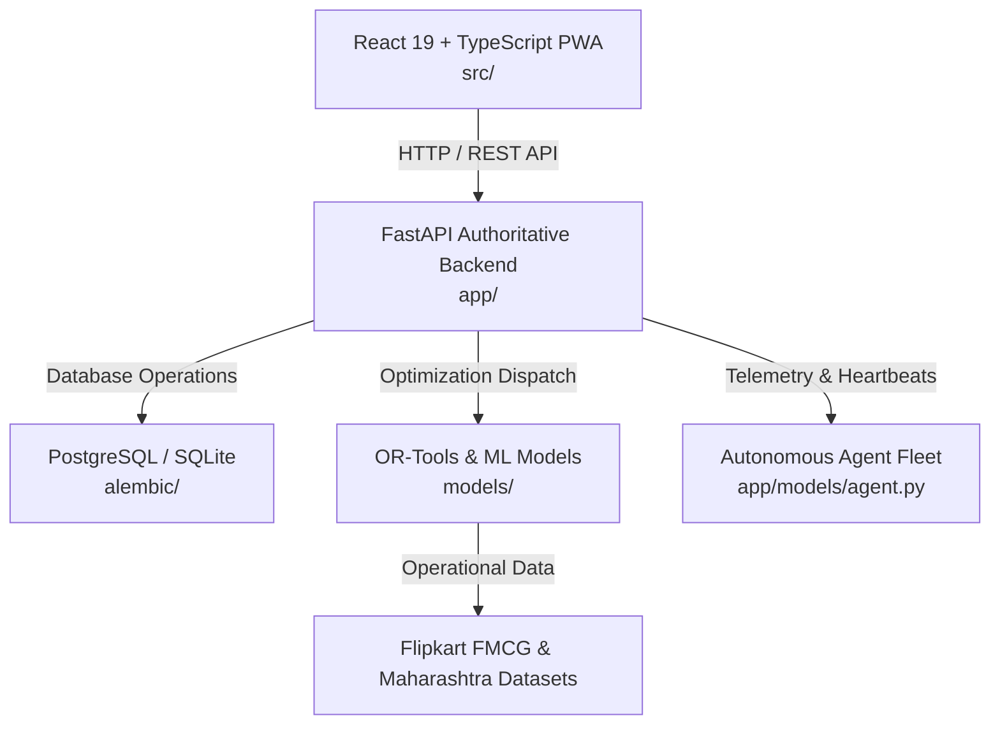

# FlowGrid Documentation Index

This directory centralizes all architectural specifications, Product Requirement Documents (PRDs), and design assets for the FlowGrid AI-Powered Distribution Intelligence Engine.

---

## 📑 Documents Directory

| Document | Format | Description |
| :--- | :--- | :--- |
| **[`PRD_FLOWGRID_V2.md`](PRD_FLOWGRID_V2.md)** | Markdown | **FlowGrid PRD v2.0**: Core architecture, constraint-aware optimization (OR-Tools CP-SAT), event-driven replanning, decision guardrails, and telemetry. |
| **[`PRD_HETVAYA_V1.5.md`](PRD_HETVAYA_V1.5.md)** | Markdown | **Hetvaya Engine PRD v1.5**: Indian FMCG traditional trade problem statement, baseline comparisons, FEFO batch-level allocation, offline sync specifications. |
| **[`media/`](media/)** | Directory | High-resolution architectural renders and UI hero visuals. |

---

## 🏗️ Architecture Summary

